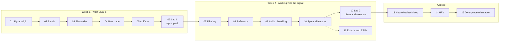

# EEG for Beginners

A two-week self-onboarding course that takes new students from zero to **"can read an EEG trace, explain what is in it, and run a basic analysis in Python"** in about six hours, before the first supervisor meeting with Alex.

It is built around **real recordings**: thirteen anonymised EDF files from consumer and research headsets, chosen because each one shows something specific (a clean alpha rhythm, heavy line noise, blinks, the same recording before and after cleaning). Every figure in the course is drawn from them by code in this repo, and every lab runs on them.

**Who it is for:** students joining the Divergence projects with some programming background and no EEG background. Everything linked is free and publicly available. No licences, no sign-ups beyond a Python install.

## How to use it

- Work through **Week 1 before Week 2**. Each session is 30-45 minutes; give the two hands-on sessions a dedicated 60-90 minute block.
- Follow the **[day-by-day schedule](schedule.md)**. It says what to read, watch and run in each session; the [resource library](resources.md) is the longer menu for when you want more.
- Keep a running **notes file** in the project repo, starting from the [notes template](notes-template.md). Write down every term you had to look up and every question for Alex.
- **Pair up** where it helps: one person drives, the other reads the docs.
- Before the first meeting, go through the **[Checkpoints](checkpoints.md)** and mark anything you cannot do yet.

## The two-week map



The Week 2 pipeline is the same one, in the same order, that nearly every EEG tool runs, including the Divergence platform: **filter, re-reference, remove artifacts, then compute features.**

## Modules

| # | Module | Week · session | Time | What you will be able to do |
| --- | --- | --- | --- | --- |
| 00 | [Start here](modules/00-start-here.md) | 1 · 1 | 15 min read, 20 min setup | Set up, know the plan |
| 01 | [Where the signal comes from](modules/01-where-the-signal-comes-from.md) | 1 · 1 | 30 min watch, 20 min read | Explain what scalp EEG measures and its limits |
| 02 | [Frequency bands](modules/02-frequency-bands.md) | 1 · 2 | 25 min read | Name the bands and what each is associated with |
| 03 | [Electrodes and montages](modules/03-electrodes-and-montages.md) | 1 · 2 | 20 min read, 10 min sketch | Place 10-20 sites; explain references and montages |
| 04 | [Reading a raw trace](modules/04-reading-a-raw-trace.md) | 1 · 3 | 20 min read, 15 min hands-on | Read a multichannel plot and spot alpha |
| 05 | [Artifacts field guide](modules/05-artifacts-field-guide.md) | 1 · 4 | 20 min watch, 25 min read, 15 min cheat sheet | Tell blinks, muscle, line noise and drift from brain |
| 06 | [Lab 1: find the alpha peak](modules/06-lab-1-find-the-alpha-peak.md) | 1 · 3 | 60-90 min hands-on | Load EDF, plot spectra, see alpha appear with eyes closed |
| 07 | [Filtering](modules/07-filtering.md) | 2 · 5 | 30 min read, 20 min hands-on | Choose high-pass, low-pass and notch settings and know their costs |
| 08 | [Re-referencing](modules/08-re-referencing.md) | 2 · 5 | 20 min read, 10 min hands-on | Apply and compare references |
| 09 | [Artifact handling](modules/09-artifact-handling.md) | 2 · 6 | 35 min read, 25 min hands-on | Reject, run ICA, understand ASR |
| 10 | [Spectral features](modules/10-spectral-features.md) | 2 · 5 | 30 min read, 15 min hands-on | Compute Welch spectra, band power, ratios |
| 11 | [Epochs and ERPs](modules/11-epochs-and-erps.md) | 2 · 6 | 20 min read, 10 min hands-on | Know the event-related vocabulary |
| 12 | [Lab 2: clean and measure](modules/12-lab-2-clean-and-measure.md) | 2 · 6 | 60-90 min hands-on | Remove a blink with ICA and measure alpha per channel |
| 13 | [The neurofeedback loop](modules/13-neurofeedback-loop.md) | 2 · 7 | 50 min: 30 min reading, 20 min hands-on | Explain protocols, thresholds and why artifacts matter online |
| 14 | [HRV basics](modules/14-hrv-basics.md) | 2 · 8 | 40 min: 25 min reading, 15 min hands-on | Compute and interpret RMSSD, SDNN, LF, HF |
| 15 | [Divergence orientation](modules/15-divergence-orientation.md) | 2 · 8 | 20 min to prepare, then the in-person walkthrough | Arrive at the platform walkthrough ready |

Reference pages: [Schedule](schedule.md) · [Checkpoints](checkpoints.md) · [Resources](resources.md) · [Glossary](glossary.md) · [Notes template](notes-template.md) · [Sample recordings](data/README.md)

## Quick start

```bash
git clone <this repo>
cd EEG_For_Beginners
python -m venv .venv
source .venv/bin/activate          # Windows: .venv\Scripts\activate
pip install -r code/requirements.txt
python code/labs/lab1_alpha_peak.py
```

Use VS Code or JupyterLab, whichever you already know. The labs are plain Python scripts that also work cell by cell in a notebook. See the [MNE install guide](https://mne.tools/stable/install/index.html) if `pip install mne` gives you trouble.

## Repository layout

```text
EEG_For_Beginners/
├── README.md                 this page
├── schedule.md               day-by-day plan, 8 sessions
├── checkpoints.md            self-assessment before the first meeting
├── resources.md              the full resource library
├── glossary.md               every term, A-Z
├── notes-template.md         copy this to start your notes file
├── AUTHORING.md              how the Markdown is written (for contributors)
├── modules/                  00-15, one Markdown file per module
├── assets/figures/           every figure, generated from the samples
├── data/
│   ├── README.md             what each sample recording is for
│   └── samples/              13 anonymised EDF files (17 MB)
├── code/
│   ├── requirements.txt
│   ├── eeg101/               small helpers: load_sample(), BANDS, montage
│   ├── labs/                 runnable lab and module scripts
│   └── figures/make_figures.py   regenerates assets/figures/
└── site/                     static site builder (HTML version of the course)
```

## Regenerating the figures

Every PNG in `assets/figures/` is drawn from the sample recordings by one function in `code/figures/make_figures.py`:

```bash
python code/figures/make_figures.py                      # all figures
python code/figures/make_figures.py artifact_gallery     # just one
```

## About the data

The samples in `data/samples/` are real recordings with their EDF header patient and recording fields blanked and the start date set to 01.01.85 (the EDF convention for anonymised files). The signals are unchanged. See [data/README.md](data/README.md) for what each file shows and how to load it.

## The website

The same content is published as a static site. To build it locally:

```bash
pip install -r site/requirements.txt
python site/build.py --serve   # builds site/dist and serves it on http://localhost:8000
```

The site adds two interactive pages that only exist in HTML: the **Signal Lab** (open any course EDF, or your own, in the browser; filter, re-reference and read the spectrum live) and an **electrode map** with a naming quiz. It is fully static, so it deploys anywhere; `vercel.json` is set up for Vercel, and pointing a subdomain at the project is all that is left. Details in [site/README.md](site/README.md).

## Credits and licence

The course structure and reading list come from the *EEG Self-Onboarding Map - Two Weeks* syllabus (Oct 15, 2026, Alex Ni). The linked lectures, decks, tutorials and papers belong to their authors and are linked, not copied. Hands-on material leans on [MNE-Python](https://mne.tools) and [NeuroKit2](https://neuropsychology.github.io/NeuroKit/).

**License: TBD.** Pick one before publishing. A common split is CC BY 4.0 for the written content and figures, and MIT for the code in `code/` and `site/`.
