# Start here

After this module you will know what the next two weeks look like, have a working Python environment that can open the course's EEG files, and have started the notes file you will bring to your first meeting with Alex.

## What this course gets you

Two weeks, about six hours of focused work in total, taking you from zero to three concrete abilities:

1. **Read an EEG trace.** Look at a raw recording and say where the signal comes from, which rhythm you are seeing, which electrode it is on, and whether a bump is brain or artifact.
2. **Explain what is in it.** Use the right vocabulary: bands, montages, references, artifacts, band power, reward and inhibit thresholds, RMSSD.
3. **Run a basic analysis in Python.** Load an EDF, filter it, remove a blink with ICA, and compute band power per channel with MNE-Python.

Everything here is free. The only install is Python and a few open-source libraries.

## How to use it

- **Week 1 before Week 2.** Each module builds on the previous one, and the two labs reuse each other's data.
- **Sessions are 30-45 minutes.** The two hands-on labs ([Lab 1](06-lab-1-find-the-alpha-peak.md) and [Lab 2](12-lab-2-clean-and-measure.md)) want a dedicated 60-90 minute block.
- **You do not need every link.** Each module says what to read, watch or run. The [resource library](../resources.md) is the longer menu for when you want more.
- **Pair up.** Hands-on sessions go faster with one person driving the keyboard and the other reading the docs.
- **The [day-by-day schedule](../schedule.md)** maps modules to dates; the [checkpoints](../checkpoints.md) list is what you should be able to do before the first meeting.

## The course map

```mermaid
flowchart LR
  subgraph W1["Week 1: what EEG is"]
    M00["00 Start here"] --> M01["01 Where the signal<br/>comes from"]
    M01 --> M02["02 Frequency bands"]
    M02 --> M03["03 Electrodes<br/>and montages"]
    M03 --> M04["04 Reading a<br/>raw trace"]
    M04 --> M05["05 Artifacts<br/>field guide"]
    M05 --> M06["06 Lab 1: find<br/>the alpha peak"]
  end
  subgraph W2["Week 2: working with the signal"]
    M07["07 Filtering"] --> M08["08 Re-referencing"]
    M08 --> M09["09 Artifact handling:<br/>rejection, ICA, ASR"]
    M09 --> M10["10 Spectral features"]
    M10 --> M11["11 Epochs and ERPs"]
    M11 --> M12["12 Lab 2: clean<br/>and measure"]
    M12 --> M13["13 The neurofeedback<br/>loop"]
    M13 --> M14["14 HRV basics"]
    M14 --> M15["15 Divergence<br/>orientation"]
  end
  M06 --> M07
```



| # | Module | Week |
| --- | --- | --- |
| 00 | [Start here](00-start-here.md) | 1 |
| 01 | [Where the signal comes from](01-where-the-signal-comes-from.md) | 1 |
| 02 | [Frequency bands](02-frequency-bands.md) | 1 |
| 03 | [Electrodes and montages](03-electrodes-and-montages.md) | 1 |
| 04 | [Reading a raw trace](04-reading-a-raw-trace.md) | 1 |
| 05 | [Artifacts field guide](05-artifacts-field-guide.md) | 1 |
| 06 | [Lab 1: find the alpha peak](06-lab-1-find-the-alpha-peak.md) | 1 |
| 07 | [Filtering](07-filtering.md) | 2 |
| 08 | [Re-referencing](08-re-referencing.md) | 2 |
| 09 | [Artifact handling: rejection, ICA, ASR](09-artifact-handling.md) | 2 |
| 10 | [Spectral features](10-spectral-features.md) | 2 |
| 11 | [Epochs and ERPs](11-epochs-and-erps.md) | 2 |
| 12 | [Lab 2: clean and measure](12-lab-2-clean-and-measure.md) | 2 |
| 13 | [The neurofeedback loop](13-neurofeedback-loop.md) | 2 |
| 14 | [HRV basics](14-hrv-basics.md) | 2 |
| 15 | [Divergence orientation](15-divergence-orientation.md) | 2 |

The Week 2 pipeline (filter, re-reference, remove artifacts, compute features) is the same one, in the same order, that nearly every EEG tool runs, including the Divergence platform.

## Set up Python

You need Python 3.10 or newer. The standard EEG library in Python is [MNE-Python](https://mne.tools/stable/index.html): free, well documented, and what every hands-on part of this course uses. The [MNE install guide](https://mne.tools/stable/install/index.html) has the full story; the short version is a fresh virtual environment.

From the root of this repository:

```bash
python3 -m venv .venv
source .venv/bin/activate          # Windows: .venv\Scripts\activate
pip install -r code/requirements.txt
```

That installs MNE, NumPy, SciPy, Matplotlib, Jupyter, an EDF reader, and two optional extras used later ([mne-icalabel](https://mne.tools/mne-icalabel/stable/index.html) in Module 09 and [NeuroKit2](https://neuropsychology.github.io/NeuroKit/) in Module 14).

Check it works:

```bash
cd code
python -c "from eeg101 import load_sample; r = load_sample('rest_ec'); print(r)"
```

You should see something like `<RawEDF | s01_rest_eyes-closed_19ch.edf, 19 x 77500 (310.0 s), ~11.3 MiB, data loaded>`.

Use VS Code or JupyterLab, whichever you already know. If you know neither, JupyterLab (`jupyter lab`) is the gentler start: you can run one line at a time and see each plot as you go.

> [!TIP]
> MNE opens an interactive browser window when you call `raw.plot()`. In a Jupyter notebook, run `%matplotlib qt` (or `%matplotlib widget`) first so you can scroll it. In a plain script, the window stays open until you close it.

## What is in this repository

| Path | What it is |
| --- | --- |
| `modules/` | The 16 modules, one Markdown file each. You are reading module 00. |
| `data/samples/` | Thirteen real, anonymised EDF recordings used throughout. The [sample catalogue](../data/README.md) says what each one is for. |
| `code/eeg101/` | Small helpers. `load_sample("rest_ec")` loads a sample with consistent channel names and electrode positions. |
| `code/labs/` | Runnable scripts for the hands-on sessions, starting with `lab1_alpha_peak.py`. |
| `code/figures/make_figures.py` | Draws every figure in the course from the sample recordings. Read it when you want to know exactly how a plot was made. |
| `assets/figures/` | The figures themselves. |
| `schedule.md`, `checkpoints.md`, `resources.md`, `glossary.md` | Day-by-day plan, self-assessment list, resource library, and every term defined in one place. |
| `notes-template.md` | A starting point for your notes file. |
| `open-source.md` | The open-source projects around this course (BrainFlow, EEG-ExPy, EEGEdu, Brainstorm, free BCI lectures), each with a ten-minute way to try it. |
| `project-branches.md` | What to read and build after the two weeks, by project. |

> [!TIP]
> The course uses MNE-Python for everything hands-on, but it is one corner of a large open ecosystem. When you want a no-code view of a pipeline, a live headset demo in the browser, or a deeper lecture series, start at [open-source projects](../open-source.md). Everything there is free, and nothing needs an account.

## The notes file habit

Keep a running notes file. Markdown in the project GitHub repo is ideal; copy [`notes-template.md`](../notes-template.md) to start. Every session, add:

- **Every term you had to look up**, with a one-line definition in your own words.
- **Every question you want to ask Alex.** No question is too basic; write it down while it is fresh.
- **Screenshots and plots** from the labs, with a sentence on what each shows.
- **Anything that surprised you.** Surprises are where the understanding is.

Bring that file to the first meeting. It turns the meeting from a lecture into a conversation about what you actually found hard.

> [!IMPORTANT]
> The single most useful thing you can do in Week 1 is write questions down. Alex can answer in five minutes what might take you an hour to find, but only if you bring the question.

## Self-check

<details><summary>What are the four steps of the standard EEG processing pipeline, in order?</summary>

Filter, re-reference, remove artifacts, compute features. Week 2 covers each one (Modules 07 to 10).

</details>

<details><summary>Which two modules need a dedicated 60-90 minute block, and why?</summary>

[Lab 1](06-lab-1-find-the-alpha-peak.md) and [Lab 2](12-lab-2-clean-and-measure.md). They are hands-on: most of the time goes on running code, reading output and looking at plots, and Lab 2 reuses Lab 1's data.

</details>

<details><summary>What should go into your notes file each session?</summary>

Terms you looked up, questions for Alex, screenshots or plots with a sentence each, and anything that surprised you.

</details>

## Next

[Module 01: Where the signal comes from](01-where-the-signal-comes-from.md)
