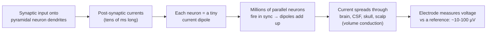

# Where the signal comes from

After this module you will be able to explain, in two or three sentences, what an EEG electrode actually measures, why the signal is so small, and why EEG is excellent at *when* but poor at *where*.

## Watch first

Start with the two-minute version, then the real thing.

1. **[2-Minute Neuroscience: EEG](https://neuroscientificallychallenged.com/posts/2-minute-neuroscience-electroencephalography-eeg)** (2 min). Day-one orientation.
2. **Mike X Cohen, "Introduction to EEG time series"**, the first lecture of his [Analyzing Neural Time Series (ANTS) playlist](https://www.youtube.com/watch?v=ukjuFUghieg&list=PLn0OLiymPak0t1moK3sn4Sl1seXlEOPHT) (about 30 min). Cohen is the clearest explainer of *why* EEG looks the way it does; the rest of the playlist reappears in Modules 07 and 10.

Prefer reading, or want a second explanation? Three free, no-login alternatives (more on the [open-source projects page](../open-source.md)):

- **[NeuroTechEDU lessons](http://learn.neurotechedu.com/lessons/)** (NeuroTechX): short written primers on EEG and neurotech. Community-maintained, so expect a few stale links.
- **[Introduction to Modern BCI Design](https://sccn.ucsd.edu/wiki/Introduction_To_Modern_Brain-Computer_Interface_Design)** (Christian Kothe, SCCN/UCSD): the first lecture and its slide PDF cover EEG basics for engineers.
- **[Introductory Neuroscience and Neuro-Instrumentation](https://onlinecourses.nptel.ac.in/noc20_ee95/preview)** (NPTEL, IISc Bangalore): weeks 2-4 cover EEG recording systems, waveforms and signal conditioning. The YouTube lectures need no login; enrolment is only for certification.

Then read the **"Basics of EEG & ERPs" slide deck** in [PURSUE Module 1](https://pursue.richmond.edu/teaching-modules/full-semester-course/module-1-overview-of-eeg-erp) (University of Richmond, free). It is a real undergraduate lecture deck: what EEG measures, how it compares to fMRI and MEG, strengths and limits. Budget 30-45 minutes; it is shared with [Module 03](03-electrodes-and-montages.md).

## The one-paragraph version

Scalp EEG is the **summed post-synaptic potentials of millions of aligned cortical pyramidal neurons**, smeared by the skull and scalp on the way to the electrode (**volume conduction**). Amplitudes are **tens of microvolts**. It has **millisecond time resolution** and **poor spatial resolution**.

If you can say that paragraph from memory and explain each bolded phrase, you have the module. The rest of this page unpacks it.

## From neuron to electrode

**Which cells.** The cortex's **pyramidal neurons** are long, and they stand side by side with their main dendrites pointing toward the surface, like trees in a planted forest. That geometry is the whole story: their currents line up, so they add instead of cancelling. Neurons with randomly oriented dendrites (most interneurons, many deep nuclei) produce fields that cancel and are essentially invisible to scalp EEG.

**Which currents.** Not action potentials. Spikes last about a millisecond and neighbouring neurons rarely spike at exactly the same instant, so their contributions do not sum. **Post-synaptic potentials** (PSPs) last tens of milliseconds, long enough that synaptic input arriving across a patch of cortex overlaps in time and adds up. When excitatory input arrives on the apical dendrites near the surface, current flows into the cell there and out near the cell body, making the neuron a tiny **current dipole**: a source and a sink a fraction of a millimetre apart.

**How many.** One dipole is far too small to see from the scalp. Estimates in the literature are that several square centimetres of cortex, tens of millions of neurons, must be active in near-synchrony to produce a measurable scalp signal. EEG therefore sees **synchronised populations**, never single cells. This is why rhythms dominate EEG: an oscillation is exactly the kind of activity that keeps large populations in step.

**Which way it points.** Cortex is folded. Dipoles on the crown of a gyrus point roughly toward the scalp (radial) and are seen best by EEG. Dipoles in the walls of a sulcus lie parallel to the scalp (tangential); EEG still sees them, but as a positive-negative pair of regions either side of the source rather than a single peak. This is why a scalp map can show a maximum some distance from the brain region actually producing it.

## Volume conduction: why the picture is blurred

Between the cortex and the electrode sit cerebrospinal fluid, the skull and the scalp. The skull conducts electricity poorly compared with brain and scalp, so current spreads sideways as it passes through. The result:

- **Every electrode sees a weighted mix of many sources**, including distant ones.
- **Neighbouring electrodes see nearly the same thing.** In a 19-channel recording, adjacent channels are highly correlated.
- **The signal is small.** By the time it reaches the scalp it is tens of microvolts. For comparison, a AA battery is 1.5 V, about 30,000 times bigger than a 50 µV alpha wave.

In the course's eyes-closed sample (`s01`), alpha waves at O1 typically swing 40-80 µV from peak to trough ([Module 02](02-frequency-bands.md) has the figure). That is a *big* EEG signal. A blink, by contrast, can be several hundred microvolts at Fp1 ([Module 05](05-artifacts-field-guide.md)), which is one reason artifacts are such a problem: the junk is often bigger than the brain.

> [!NOTE]
> Raw files from the course's headsets also carry a huge constant **DC offset**: in `s01`, channel medians sit anywhere from about -198,000 to +43,000 µV. That offset comes from the electrode-skin contact, not the brain, and a high-pass filter removes it. You will see this in [Module 04](04-reading-a-raw-trace.md).

## Time versus space

EEG measures electrical activity directly, with nothing in between to slow it down, so a change in cortical activity shows up at the electrode instantly. Sampling at 250 Hz (the course samples) gives one value every 4 ms; research systems often sample at 500-2000 Hz. Spatially, volume conduction blurs each source over several centimetres of scalp, so with 19 electrodes you can say "left frontal" or "back of the head", not "this gyrus".

| | EEG | MEG | fMRI |
| --- | --- | --- | --- |
| What it measures | Voltage at the scalp from post-synaptic currents | Magnetic field from the same currents | Blood oxygenation changes (BOLD), an indirect, slow consequence of neural activity |
| Time resolution | Milliseconds | Milliseconds | Seconds (the haemodynamic response peaks about 5-6 s after activity) |
| Spatial resolution | Centimetres, blurred by skull | Better than EEG: magnetic fields pass through the skull almost undistorted | Millimetres |
| Sensitive to | Radial and tangential sources, gyri and sulci | Mostly tangential sources (sulcal walls); nearly blind to purely radial ones | Whole brain, including deep structures |
| Equipment | Cap or headset, amplifier; portable, wearable, cheap | Magnetically shielded room, cryogenic or optically pumped sensors; expensive | MRI scanner; expensive, noisy, no movement |
| Can you use it at home, in real time? | Yes | No (with current mainstream systems) | No |

That last row is why neurofeedback is almost always EEG: it is the only one of the three you can wear on a couch and compute on in real time.

## Strengths and limits in one list

**Strengths:** direct measure of neural activity; millisecond timing; cheap and portable; tolerant of a person sitting and doing a task; decades of literature on rhythms and evoked responses.

**Limits:** poor spatial resolution; blind to deep structures and to activity that is not synchronised across a large patch of cortex; tiny signal, so contamination by eyes, muscles, the heart and the mains supply is the normal state of affairs ([Module 05](05-artifacts-field-guide.md)); every channel is a *difference* between two electrodes, so the choice of reference changes the picture ([Module 08](08-re-referencing.md)).

## Self-check

Why do action potentials contribute so little to scalp EEG?

They last about a millisecond and neighbouring neurons rarely fire at exactly the same moment, so their fields do not add up. Post-synaptic potentials last tens of milliseconds, overlap in time across a population, and sum.

Why pyramidal neurons, and not every neuron?

Pyramidal neurons are aligned in parallel with their dendrites perpendicular to the cortical surface, so their current dipoles point the same way and add. Cells with random dendritic orientation produce fields that cancel.

What is volume conduction, and name two consequences.

The spread of current through brain, CSF, skull and scalp between the source and the electrode. Consequences: each electrode sees a mix of many sources (poor spatial resolution); neighbouring electrodes are highly correlated; the signal is attenuated to tens of microvolts.

A colleague wants to know which millisecond a response starts and roughly where on the head it is largest. EEG or fMRI?

EEG: millisecond timing and a coarse scalp location are exactly what it gives. fMRI would give a precise location but blur the timing over seconds.

Roughly how big is a large alpha wave at O1 in the course sample, and how big is a blink at Fp1?

Alpha: about 40-80 µV peak to trough. A blink: several hundred microvolts. The artifact can be larger than the brain signal.

## Notes file prompts

- Write the one-paragraph version in your own words without looking.
- Add to your glossary: pyramidal neuron, post-synaptic potential, dipole, volume conduction, µV.
- Question for Alex: which of the limits above matter most for the Divergence headsets?

## Next

[Module 02: Frequency bands](02-frequency-bands.md)
