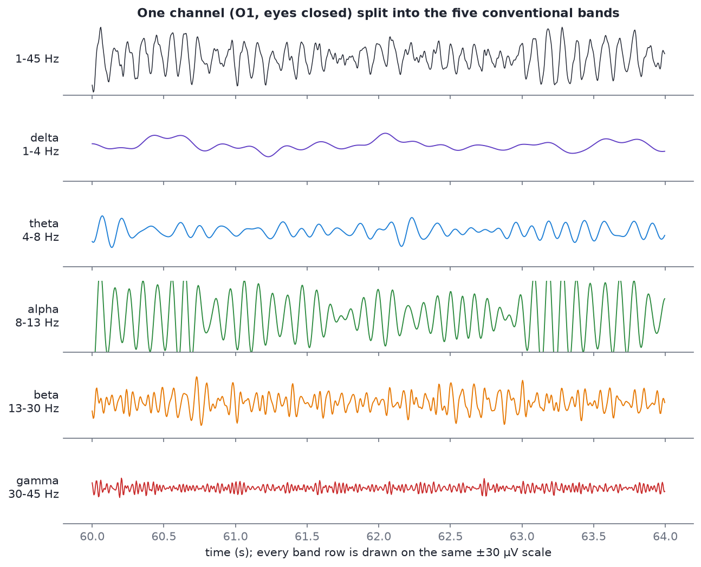
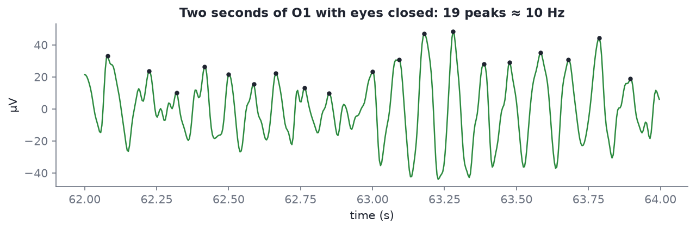

# Frequency bands

After this module you will be able to name the five classic EEG bands with their approximate edges, say what state or location each is associated with, and point at the alpha peak in a real spectrum.

## Why bands at all

An EEG trace looks like noise at first, but it is a mixture of rhythms at different speeds. Splitting it into frequency bands is the oldest and still the most useful way to describe it, and it is what neurofeedback protocols train on ([Module 13](13-neurofeedback-loop.md)). A rhythm's **frequency** is how many cycles it completes per second, in hertz (Hz).

*Four seconds of O1 from `s01_rest_eyes-closed_19ch.edf`. The top row is the broadband signal (1-45 Hz); each row below keeps only one band. Every band row uses the same ±30 µV scale, so you can compare sizes directly: alpha is so large it runs off the edge.*

Look at that figure carefully. The broadband trace on top is literally the sum of the five rows below it. With eyes closed, the alpha row dominates, which is why the top trace already looks like a regular ripple.

## The five bands

| Band | Range (Hz) | Where and when you see it | Associated with |
| --- | --- | --- | --- |
| **Delta** | 0.5-4 | Widespread; dominant in deep (slow-wave) sleep. In awake adults, large delta usually means artifact (eye movements, drift, movement) or pathology | Deep sleep |
| **Theta** | 4-8 | Frontal midline (Fz) during effortful thinking; widespread in drowsiness | Drowsiness, memory, **frontal-midline theta** during mental effort |
| **Alpha** | 8-13 | **Strongest at the back of the head (O1, O2, Pz) with eyes closed**; blocked by opening the eyes | Relaxed wakefulness. The posterior alpha rhythm is the single most reliable thing in human EEG |
| **Beta** | 13-30 | Frontal and central; around the motor strip (C3, Cz, C4) | Active thinking, alertness, motor control. The low end (about 12-15 Hz over the sensorimotor strip) is called **SMR**, sensorimotor rhythm |
| **Gamma** | 30+ | Hard to see on the scalp | Local cortical processing; **very hard to separate from muscle activity**, which covers the same frequencies |

The course uses these edges in code (`eeg101.BANDS`): delta 1-4, theta 4-8, alpha 8-13, beta 13-30, gamma 30-45 Hz. The lower edge of delta is set to 1 Hz there because the course filters out everything below 1 Hz, and the upper edge of gamma to 45 Hz because consumer headsets and a 40-45 Hz low-pass leave nothing useful above it.

> [!IMPORTANT]
> **Band edges vary by author; treat them as conventions.** You will see alpha as 8-12, 8-13 or 7.5-12.5 Hz, and beta split into low/mid/high in a dozen ways. A person's own alpha peak can sit anywhere from roughly 8 to 12 Hz, and it shifts with age and alertness. When you read a paper or a protocol, check which edges it uses before comparing numbers.

## Alpha, up close

Alpha is the first thing you should learn to spot. In a healthy adult with eyes closed, it is a visible ripple at about 10 cycles per second over the back of the head.

*Two seconds of O1 from `s01_rest_eyes-closed_19ch.edf`, filtered 1-40 Hz. Counting peaks is the crudest possible frequency estimate, and it works: 19 peaks in 2 seconds, about 10 Hz. Peak-to-trough swings here are roughly 40-80 µV.*

Notice two things:

- **It waxes and wanes.** Alpha comes in "spindles" lasting a second or two, growing and shrinking. That is normal.
- **It is sinusoidal but not a perfect sine.** Real rhythms have slightly sharp peaks and wobbling period. That is why a spectrum shows a *bump* around 10 Hz, not a single spike.

## Seeing bands in a spectrum

A **power spectrum** (or PSD, power spectral density) answers "how much of each frequency is in this signal?". The x-axis is frequency, the y-axis is power. [Module 10](10-spectral-features.md) shows how it is computed; for now, learn to read one.

*Left: mean spectrum of O1, O2 and Pz from `s01_rest_eyes-closed_19ch.edf` (green) and `s02_rest_eyes-open_19ch.edf` (grey), same person, same session. Right: alpha power (8-13 Hz) with eyes closed divided by eyes open, for every channel.*

What to read off it:

- **The 1/f slope.** Power falls steadily with frequency. Every EEG spectrum has this downward slope; rhythms appear as bumps *on top of* it.
- **The alpha peak.** Eyes closed, a large peak at **10 Hz**, about 22 dB above 1 µV²/Hz in the O1/O2/Pz average. Eyes open, it collapses to a small bump near 12 Hz. A difference of 10 dB is a factor of 10 in power, so this is more than a tenfold change.
- **Alpha reactivity is posterior.** On the right, O1 and O2 show alpha about **18 times** higher with eyes closed; frontal and temporal-anterior channels change by less than a factor of 2. Opening the eyes blocks alpha most where alpha is largest, at the back.
- **A beta bump.** The eyes-closed spectrum also has a smaller bump near 20 Hz. Second bumps at roughly twice the alpha frequency are common, partly because alpha waves are not perfect sines.
- **Delta rises with eyes open.** Eyes open, delta makes up 47% of O1's 1-45 Hz power against 5% eyes closed. That is not deep sleep: it is eye movements and blinks leaking into the slowest frequencies. Low-frequency power in an awake recording is a first suspect for artifact.

Relative band power at O1 (share of 1-45 Hz power) puts numbers on it:

| | Delta | Theta | Alpha | Beta | Gamma |
| --- | --- | --- | --- | --- | --- |
| O1, eyes closed | 5% | 3% | **83%** | 9% | 1% |
| O1, eyes open | 47% | 12% | 20% | 16% | 6% |
| Fz, eyes closed | 28% | 13% | 44% | 13% | 2% |

*Computed from `s01` and `s02` with a median-averaged Welch spectrum, 1-45 Hz band-pass.*

## Frequency, period and the sampling rate

Two quick relationships you will use constantly:

- **Period = 1 / frequency.** A 10 Hz rhythm repeats every 100 ms; a 4 Hz theta wave every 250 ms; 60 Hz mains every 16.7 ms.
- **The Nyquist limit.** A recording sampled at rate *fs* can only represent frequencies up to *fs*/2. The course samples are 250 Hz, so nothing above 125 Hz exists in them. The PhysioNet data in [Lab 1](06-lab-1-find-the-alpha-peak.md) is 160 Hz, so its ceiling is 80 Hz.

## Self-check

Give the approximate range and the typical state for each of the five bands.

Delta 0.5-4 Hz, deep sleep. Theta 4-8 Hz, drowsiness, memory, frontal-midline theta in effort. Alpha 8-13 Hz, relaxed wakefulness, strongest at the back with eyes closed. Beta 13-30 Hz, active thinking and motor activity. Gamma 30+ Hz, hard to separate from muscle.

You see a peak at 10 Hz that is largest at O1 and O2 and almost disappears when the person opens their eyes. What is it?

The posterior alpha rhythm. Location (occipital), frequency (about 10 Hz) and reactivity (blocked by eye opening) all match.

Why should you be suspicious of a lot of delta power in an awake, eyes-open recording?

Delta dominates in deep sleep, not wakefulness. In an awake person, large slow activity is usually eye movements, blinks, sweat or movement drift. In the course sample, delta goes from 5% to 47% of O1 power when the eyes open, largely from eye artifacts.

Why is gamma especially hard to measure from the scalp?

Muscle activity (EMG) from the scalp, jaw and face covers the same frequencies (roughly 20 Hz and up) and is often far larger than cortical gamma at the scalp.

A paper defines alpha as 8-12 Hz; your protocol uses 8-13 Hz. Can you compare alpha power numbers directly?

Not exactly. The bands cover different frequency ranges, so the absolute numbers differ. Band edges are conventions: always check them before comparing.

> [!TIP]
> **Have a Muse 2 or Muse S?** [EEGEdu](https://github.com/kylemath/EEGEdu) (Mathewson lab, University of Alberta; MIT licence; no login) streams it into your browser over Web Bluetooth and shows the raw signal, filters, spectra and bands live. Close your eyes and watch alpha appear at the back channels. It is the browser successor to the archived NeuroTechX app EEG 101. No headset: the course's [Signal Lab](https://eeg-for-beginners.vercel.app/lab/signal-lab) does the same with the sample recordings.

## Notes file prompts

- Draw the five bands on a frequency axis from memory, with one association each.
- Screenshot or sketch the eyes-closed vs eyes-open spectrum and label the alpha peak and the 1/f slope.
- Question for Alex: which bands and edges do the Divergence protocols use?

## Next

[Module 03: Electrodes and montages](03-electrodes-and-montages.md)
