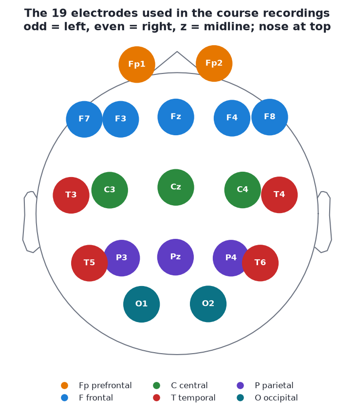

# Electrodes and montages

After this module you will be able to place Fz, Cz, Pz and Oz on a head, decode any 10-20 name (letter = region, odd = left, even = right, z = midline), explain what a reference electrode is, and say why referential and bipolar montages give different pictures of the same brain.

## Read first

- Skim the Wikipedia page on the [10-20 system](<https://en.wikipedia.org/wiki/10%E2%80%9320_system_(EEG)>) until you can place Fz, Cz, Pz, Oz and know that odd numbers are left hemisphere, even are right, and "z" is midline.
- If you have not finished it in Module 01, the [PURSUE Module 1](https://pursue.richmond.edu/teaching-modules/full-semester-course/module-1-overview-of-eeg-erp) "Basics of EEG & ERPs" deck covers recording setups too.

## The 10-20 system

Electrode positions are standardised so that "Cz" means the same spot on every head. The name **10-20** comes from how the positions are measured: distances between neighbouring electrodes are **10% or 20%** of the total front-to-back (nasion to inion) or left-to-right (ear to ear) distance across the skull. Because the spacing is a percentage, the layout scales to any head size.



*The 19 electrodes in the course's 19-channel samples (`s01`-`s08`), template positions from MNE. Nose at the top, left ear on the left.*

### Decoding a name

Every name is **letters for the region** plus **a number or z for the side**:

| Letter | Region | Examples |
| --- | --- | --- |
| Fp | Frontopolar (prefrontal, over the forehead) | Fp1, Fp2 |
| F | Frontal | F7, F3, Fz, F4, F8 |
| C | Central (over the motor and sensory strips) | C3, Cz, C4 |
| T | Temporal (above the ears) | T3, T4, T5, T6 (or T7, T8, P7, P8) |
| P | Parietal | P3, Pz, P4 |
| O | Occipital (back of the head, over visual cortex) | O1, O2 (and Oz) |

- **Odd numbers are on the left, even on the right.** F3 is left frontal, F4 is right frontal.
- **Numbers grow away from the midline.** F3 is closer to the middle than F7.
- **z means zero, the midline.** Fz, Cz, Pz, Oz run front to back down the centre of the head. **Cz** is the vertex, the top of the head, halfway between nose and back and halfway between the ears.

"C" means central, not cerebellum; there is no lobe called "central", the row simply runs over the central sulcus. More generally, electrodes do not sit precisely over the lobes they are named after; the names are approximate.

### Old and new names

The extended **10-10 system** adds positions between the original ones (FC3, CP4, PO7 and so on) and renamed four of the originals so the naming is consistent:

| 10-20 (old) | 10-10 (new) |
| --- | --- |
| T3 | T7 |
| T4 | T8 |
| T5 | P7 |
| T6 | P8 |

They are the **same places**. You will meet both: most of the course files use T3-T6, one uses T7/T8/P7/P8, and clinical software often still prints the old names. The course loader `eeg101.load_sample()` renames the new ones to the old ones so every sample matches, and MNE's template montage understands both.

### Channel counts

| Setup | Channels | In this course |
| --- | --- | --- |
| Research caps | 32, 64, 128, 256 | PhysioNet data in [Lab 1](06-lab-1-find-the-alpha-peak.md): 64 channels |
| Clinical / qEEG standard | 19 (the classic 10-20 set) | `s01`-`s08` |
| Consumer / neurofeedback headsets | 1-8 | `s09`-`s10` (8 ch: Cz, F3, F4, O1, O2, Pz, T3, T4), `s11`-`s13` (4 ch: F3, F4, Cz, O1) |

Fewer channels means less spatial information, but as the 4-channel headband samples show in [Module 10](10-spectral-features.md), one well-placed O1 electrode is enough to see eyes-closed alpha.

## The reference: every channel is a difference

An EEG amplifier cannot measure "the voltage at Fp1". Voltage is always a **difference between two points**. Every channel is therefore:

> channel = voltage at the electrode − voltage at the **reference**

The reference is just another electrode (or a combination of electrodes) chosen to sit somewhere hopefully quiet. Common choices:

| Reference | What it is | Trade-offs |
| --- | --- | --- |
| **A single electrode** (Cz, an earlobe, a mastoid) | One physical site | Simple. Anything happening at the reference appears, inverted, in every channel; the reference channel itself becomes flat |
| **Linked mastoids / linked ears** | Average of the bony bumps behind both ears (or both earlobes) | Fairly quiet, symmetric; picks up temporal muscle and ECG |
| **Average reference** | The mean of all channels, subtracted from each | No single site dominates; works best with many channels evenly covering the head, poorly with 4-8 |
| **Device reference** | Whatever the headset was built with (often an ear clip, mastoid or a forehead site, sometimes with a separate "ground"/bias electrode) | Check the hardware documentation; it is not always printed in the file |

The **ground** (or bias, DRL) electrode is different: it helps the amplifier reject common noise and is not part of any channel.

> [!TIP]
> For the hardware side of this, read OpenBCI's [EEG setup guide](https://docs.openbci.com/GettingStarted/Biosensing-Setups/EEGSetup/): which pins the reference and bias wires go into, 10-20 placement on a real cap, and a walk-through of recording your own alpha. It is the most practical "what is a reference electrode" page on the web, needs no login, and the [docs site](https://docs.openbci.com/) is MIT licensed.

**Why it matters:** the same brain activity looks different under different references. A signal present at the reference electrode is subtracted from every channel. A rhythm that is equal at two sites vanishes from the difference between them. [Module 08](08-re-referencing.md) shows the same three seconds under four references, and how to change reference after recording in MNE.

## Montages: how channels are displayed

A **montage** is the set of electrode pairs you choose to look at. ("Montage" is also used in MNE for the 3D *positions* of the electrodes, as in `raw.set_montage(...)`. Context tells you which meaning.)

**Referential montage.** Each channel is shown against a common reference: Fp1-ref, F3-ref, C3-ref and so on. Amplitudes are easy to compare between channels, and you can see where an activity is largest. This is the default for analysis.

**Bipolar montage.** Each channel is the difference between two *neighbouring* electrodes, usually in chains. The standard clinical "double banana" (longitudinal bipolar) runs front to back down each side:

| Chain | Electrodes, front to back | Channels |
| --- | --- | --- |
| Left temporal | Fp1 → F7 → T3 → T5 → O1 | Fp1-F7, F7-T3, T3-T5, T5-O1 |
| Left parasagittal | Fp1 → F3 → C3 → P3 → O1 | Fp1-F3, F3-C3, C3-P3, P3-O1 |
| Right parasagittal | Fp2 → F4 → C4 → P4 → O2 | Fp2-F4, F4-C4, C4-P4, P4-O2 |
| Right temporal | Fp2 → F8 → T4 → T6 → O2 | Fp2-F8, F8-T4, T4-T6, T6-O2 |

Drawn on the head map, the two chains on each side form a pair of curved bands, hence "banana".

Bipolar channels:

- **cancel anything shared** by the two neighbours, including distant sources and the reference, so they emphasise **local** activity;
- make a focal event show up as a **phase reversal**: in a chain, the two channels either side of the source deflect in opposite directions, which is how clinicians localise spikes;
- make widespread activity (like alpha present equally at P3 and O1) look **smaller** than it is.

Neither montage is "right". They answer different questions: referential for *how big and where*, bipolar for *how local*.

## Exercise: sketch it from memory

Close the browser and sketch a head from above (nose at the top) with these 17 electrodes:

**Fp1, Fp2, F3, Fz, F4, C3, Cz, C4, P3, Pz, P4, O1, O2, T3/T7, T4/T8**, then add F7, F8, T5/P7 and T6/P8 if you can.

Check it against the [electrode layout figure](../assets/figures/electrode_layout.png). Common mistakes: putting T3 behind the ear (it is above it), swapping odd and even, forgetting that F7 and F8 are further out than F3 and F4. Photograph the sketch for your notes file.

## Try it in Python

```python
from eeg101 import load_sample

raw = load_sample("rest_ec")
print(raw.ch_names)                 # the 19 names
raw.plot_sensors(show_names=True)   # top-down map with labels
```

## Self-check

<details><summary>Where is C4, and where is Fz?</summary>

C4: central row, right hemisphere (even number), between Cz and T4. Fz: frontal row, on the midline (z).

</details>

<details><summary>What does the "10-20" in 10-20 system refer to?</summary>

Neighbouring electrodes are spaced at 10% or 20% of the total front-to-back or left-to-right distance across the skull, so the layout scales with head size.

</details>

<details><summary>One file has a channel T7, another has T3. Are they different places?</summary>

No. T7 is the 10-10 name for the old 10-20 site T3. Likewise T4 = T8, T5 = P7, T6 = P8.

</details>

<details><summary>If you record with Cz as the reference, what does the Cz channel look like, and why?</summary>

Flat: it is Cz minus Cz, which is zero. And anything happening at Cz appears inverted in every other channel.

</details>

<details><summary>Alpha is equally strong at P3 and O1. What does the bipolar channel P3-O1 show?</summary>

Very little alpha: a bipolar channel is the difference between neighbours, so activity shared by both cancels. Bipolar montages emphasise local differences.

</details>

## Notes file prompts

- Photo of your sketch, with corrections.
- Add to your glossary: 10-20, reference, ground, referential montage, bipolar montage, average reference, linked mastoids, phase reversal.
- Question for Alex: what is the hardware reference and ground on each Divergence headset?

## Next

[Module 04: Reading a raw trace](04-reading-a-raw-trace.md)
