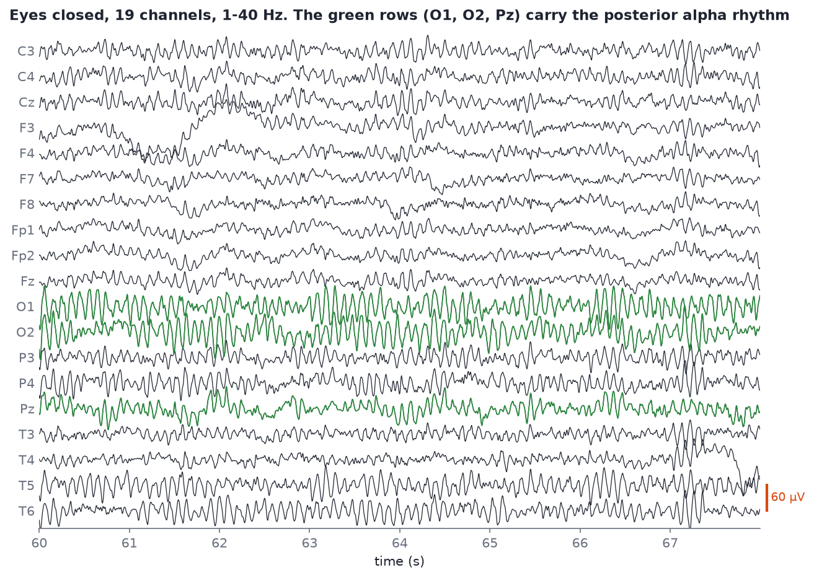

# Reading a raw trace

After this module you will be able to open an EDF in MNE, navigate it with the keyboard, read time, channel and amplitude off the display, and run a five-point first-look check on any new recording. You will also be able to spot eyes-closed alpha: a visible 10 Hz ripple over O1, O2 and Pz.

## Anatomy of the display

Every EEG viewer, from clinical software to MNE, uses the same layout:

- **Time on the x-axis**, usually 10 seconds per screen.
- **One row per channel**, conventionally front of the head at the top, back at the bottom (or grouped by chain in a bipolar montage).
- **A scale bar in microvolts** showing how tall a given voltage is. Without it, you cannot tell a 20 µV ripple from a 200 µV one. Always check it before judging size.
- **Upward deflection** is positive voltage by default in MNE. (Clinical EEG traditionally plots negative *up*. If someone says a blink "goes down", check which convention they use.)



*Eight seconds of `s01_rest_eyes-closed_19ch.edf`, filtered 1-40 Hz, 60 µV between rows. The green rows (O1, O2, Pz) carry the posterior alpha rhythm.*

What to read off this figure:

- **The bottom rows ripple at about 10 Hz.** That regular ripple on O1, O2 and Pz (and less so P3, P4, T5, T6) is eyes-closed alpha. Count the cycles in one second if you doubt it.
- **The top rows are quieter and less regular.** Frontal channels carry less alpha.
- **Nothing is perfectly clean.** There are small slow wobbles and a few sharp bits. That is normal for real data.

## Where the alpha is

A **topomap** is a top-down head drawing coloured by some value at each electrode, interpolated in between. Here the value is alpha power.


*Alpha power (8-13 Hz, dB) from `s01` (eyes closed) and `s02` (eyes open), same colour scale. Eyes closed, alpha is concentrated over the occipital electrodes; eyes open, it drops everywhere.*

If you ever compute an eyes-closed alpha topomap and the maximum is *not* at the back of the head, suspect the montage (electrode positions attached wrongly) or the channel names before you suspect the brain.

## Navigating in MNE

```python
from eeg101 import load_sample

raw = load_sample("rest_ec")
raw.filter(1.0, 40.0)                          # see Module 07 for why
raw.plot(duration=10, n_channels=19, scalings=dict(eeg=50e-6))
```

`scalings=dict(eeg=50e-6)` sets how many volts fill one row's height (here 50 µV); MNE works in volts internally, so microvolts are written `e-6`.

Keyboard shortcuts in MNE's browser window (press `?` in the window for the full list in your version):

| Key | Does |
| --- | --- |
| ← / → | Scroll back / forward in time |
| ↑ / ↓ | Scroll through channels |
| `+` / `-` | Increase / decrease amplitude scaling |
| Page Up / Page Down | Show more / fewer channels |
| Home / End | Shorter / longer time window |
| `a` | Annotation mode: drag to mark a segment (for example "BAD_blink") |
| Click a channel name | Mark it bad (it turns grey) |
| `?` | Help |

> [!TIP]
> In Jupyter, run `%matplotlib qt` before plotting so the browser opens in its own scrollable window. If you installed `mne-qt-browser`, MNE uses its faster Qt viewer automatically; the keys are the same.

## The first-look checklist

Do this with **every** new file, before computing anything. It takes two minutes and saves hours.

1. **What is in it?** `print(raw.info)` and `print(raw.ch_names)`. How many channels, which names, which sampling rate, how long?
2. **Is the sampling rate what you think?** Read `raw.info["sfreq"]`, never assume. In the course samples, `s02` is **249 Hz** and `s09`/`s10` are **251 Hz**, not 250. Code that hard-codes 250 will be subtly wrong.
3. **Is there a DC offset?** Raw dry-electrode data sits far from zero: channel medians in `s01` range from about **-198,000 to +43,000 µV**. That is the electrode-skin interface, not brain. MNE's viewer hides it by default (`remove_dc=True`), but statistics on the unfiltered data will not. A high-pass filter ([Module 07](07-filtering.md)) removes it.
4. **What do the start and end look like?** People take headsets off before stopping the recording. In `s05` and `s06` the last 4-5 seconds swing over **300,000 µV** peak to peak, against a few hundred to a couple of thousand microvolts per 5 s window earlier in the same recordings. Scroll to the end (press End, then →) before you analyse anything, and crop the junk: `raw.crop(tmax=raw.times[-1] - 5)`.
5. **Any flat or crazy channels?** Scroll through once at a sensible scale. A flat line or a channel ten times bigger than its neighbours is an electrode problem; mark it bad.

```python
import numpy as np

raw = load_sample("artifacts_ec")             # s05, unfiltered
sf = raw.info["sfreq"]
print(raw.info["sfreq"], len(raw.ch_names), raw.times[-1])
last5 = raw.get_data()[:, -int(5 * sf):] * 1e6
print("peak-to-peak in the last 5 s (µV):", np.ptp(last5, axis=1).max().round())
```

## Spotting eyes-closed alpha by eye

Eyes-closed alpha in a healthy adult is the first pattern to learn because it is so reliable:

- **Frequency:** roughly 8-12 Hz; count about 10 cycles per second.
- **Location:** largest at O1, O2 (and Oz if present), then Pz, P3, P4, T5, T6.
- **Shape:** rounded, sinusoidal waves that wax and wane in spindles of a second or two.
- **Reactivity:** it shrinks or disappears within a fraction of a second when the eyes open. If you have an eyes-open recording from the same session (`s02`), scroll both at the same scale and compare the bottom rows.

Not everyone has strong alpha. A minority of healthy adults have low-amplitude alpha that is hard to see by eye; it still shows up in a spectrum ([Lab 1](06-lab-1-find-the-alpha-peak.md)).

## Exercise

1. Open `s01` with the code above. Find a 10-second stretch where alpha is obvious and screenshot it.
2. Open `s02` (eyes open) at the same scaling. Screenshot the same channels.
3. Run the first-look checklist on `s05` (`load_sample("artifacts_ec")`). Write down the sampling rate, duration, and where the junk at the end starts.

## Self-check

<details><summary>Name the three things you must read off any EEG display before interpreting it.</summary>

The time axis (how many seconds per screen), which channel each row is, and the amplitude scale (µV per row or the scale bar).

</details>

<details><summary>Your eyes-closed alpha topomap peaks at the forehead. What do you check first?</summary>

The montage and channel names: positions attached wrongly, or names not matched to positions. Eyes-closed alpha should be posterior.

</details>

<details><summary>Why read `raw.info["sfreq"]` instead of assuming 250 Hz?</summary>

Devices do not always record at round rates; two course samples are 249 and 251 Hz. Anything computed in samples (window lengths, filter design, time stamps) is wrong if the rate is wrong.

</details>

<details><summary>Raw values in a file are around -150,000 µV. Is the person's brain doing something extreme?</summary>

No. That is a DC offset from the electrode-skin contact. Brain signals are tens of microvolts riding on top. A high-pass filter removes the offset.

</details>

## Notes file prompts

- Screenshots from the exercise, labelled.
- Your own copy of the first-look checklist.
- Question for Alex: what does the Divergence viewer do by default about DC offset and filtering?

## Next

[Module 05: Artifacts field guide](05-artifacts-field-guide.md)
