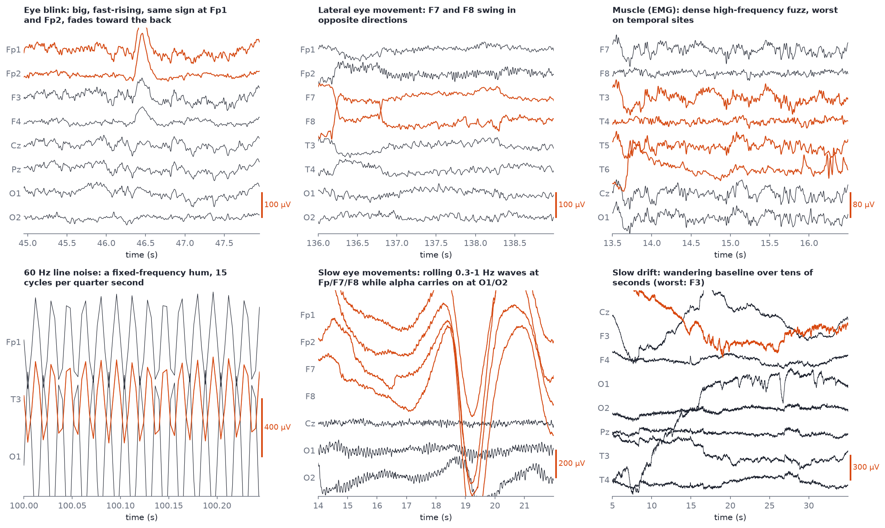

# Artifacts field guide

After this module you will be able to look at a stretch of raw EEG and name the artifact: blink, lateral eye movement, muscle, heartbeat, line noise, electrode pop, drift or movement. You will know where on the head each one is largest and which frequency band it contaminates, and you will have written your own one-page cheat sheet.

**Most of EEG work is telling these apart from brain.** An artifact is any signal in the recording that does not come from the brain. Because brain signals are tens of microvolts ([Module 01](01-where-the-signal-comes-from.md)), almost anything electrical near the head is as big or bigger.

## Watch first

Pick one (about 20 minutes):

- The [Online EEGLAB Workshop](https://www.sccn.ucsd.edu/wiki/Online_EEGLAB_Workshop) video **"Removing Artifactual Components"** (Arnaud Delorme, UCSD). EEGLAB is MATLAB, but the concepts transfer directly.
- Julian Keil's **"EEG Data Analysis Part 3 - Basics"**, listed on the [FieldTrip video page](https://www.fieldtriptoolbox.org/video/) (Donders Institute).

## The gallery



*Six real artifacts from the course samples, highlighted in orange. Top row: a blink in `s06_pipeline_stage0_raw_19ch.edf`; a lateral eye movement in `s02_rest_eyes-open_19ch.edf`; muscle in `s06`. Bottom row: line noise in `s03_linenoise_raw_19ch.edf` (only 0.25 s shown); slow rolling eye movements in `s05_artifacts_eyes-closed_19ch.edf`; slow drift in `s09_segments_original_8ch.edf` (30 s shown). Note the different scale bars.*

Panel by panel:

1. **Eye blink.** A large, fast-rising, rounded bump lasting about 200-400 ms, the **same sign at Fp1 and Fp2**, smaller at F3/F4 and nearly gone by the back of the head. The eyeball is an electrical dipole (cornea positive relative to retina); the eyelid sliding over it during a blink changes the field at the forehead electrodes.
2. **Lateral eye movement.** Look left or right and the corneal dipole swings sideways: **F7 and F8 deflect in opposite directions** (one up, one down), often as a step that holds while the gaze holds, then steps back. Opposite sign at F7 and F8 is the signature.
3. **Muscle (EMG).** Dense, spiky, high-frequency "fuzz" riding on top of the EEG, worst at **temporal sites (T3, T4, T5, T6) and F7/F8**, over the jaw and temple muscles. Jaw clenching, chewing, talking, frowning and a tense neck all do it.
4. **60 Hz line noise.** A perfectly regular hum at the mains frequency: here, 15 cycles in a quarter second. It looks like a thick band of fuzz at normal time scales. In `s03` it is hundreds of microvolts, swamping the EEG entirely. (Mains is 60 Hz in North America, including Toronto; 50 Hz in most of the rest of the world.)
5. **Slow eye movements.** In `s05` the person's eyes are closed but keep rolling slowly: big 0.3-1 Hz waves at Fp1, Fp2, F7 and F8, while alpha carries on unaffected at O1 and O2. Common when drowsy. Note the 200 µV scale bar.
6. **Slow drift.** The baseline wanders over tens of seconds, by hundreds of microvolts, on some channels more than others. Caused by sweat changing the electrode-skin contact, the electrode gel drying, or slow movement of the cable or headset.

## Two that are not in the gallery

**Heartbeat (ECG / pulse).** The heart's electrical field is far larger than the brain's and reaches the head. It appears as a small, sharp, **regularly repeating** spike about once a second (at the heart rate), often most visible at left temporal and mastoid or ear sites, and in a reference electrode near a blood vessel. A related **pulse artifact** is a slow periodic wave at the same rate when an electrode sits over an artery. The tell is the rhythm: check whether the spikes keep time with the pulse (around 60-100 per minute at rest).

**Electrode pop.** A sudden, very steep jump on **one channel only**, sometimes followed by a slow return to baseline, caused by a momentary change in the electrode-skin contact (a bubble in the gel, a dry electrode shifting). Brain activity never appears on exactly one electrode with nothing at its neighbours, because volume conduction spreads everything over several centimetres. A single-channel event with a vertical edge is an electrode, not a neuron.

**Movement.** Head or body movement produces large, irregular, slow-to-medium deflections on many channels at once, often with muscle on top. Cable sway gives slow swings. In a consumer headset, touching the band or adjusting it produces enormous swings; this is what the junk at the end of `s05` and `s06` is.

## The cheat-sheet table

| Artifact | What it looks like | Where it is largest | Frequencies it contaminates | How to tell it from brain |
| --- | --- | --- | --- | --- |
| **Eye blink** | Big rounded bump, 200-400 ms, often 100-400 µV | Fp1, Fp2, falling off toward the back | Delta and theta (below about 7 Hz) | Same sign at Fp1 and Fp2, frontal gradient, too big for frontal EEG, coincides with blinks on video or an EOG channel |
| **Lateral eye movement** | Step or slow swing, holds while gaze holds | F7 and F8 | Delta | **Opposite sign at F7 and F8** |
| **Slow eye movements** | Rolling 0.3-1 Hz waves | Fp1, Fp2, F7, F8 | Delta | Frontal, very slow, often with drowsiness; alpha at the back continues |
| **Muscle (EMG)** | Dense spiky fuzz, bursts | T3, T4, T5, T6, F7, F8 (jaw, temples), also neck muscles at the back | Beta and gamma (from about 20 Hz up), broadband | Too fast and irregular for brain; starts and stops with clenching or talking; worst at the edge of the head |
| **Heartbeat (ECG)** | Small sharp spike about once a second | Left temporal, mastoid or ear sites, reference | Spikes are broadband; the rhythm repeats at about 1 Hz | Perfectly regular at the heart rate; lines up with a pulse or ECG channel |
| **60 Hz line noise** (50 Hz outside North America) | Regular fast hum, thick fuzzy band | Any channel with poor contact; often all | A sharp spike at exactly 60 Hz (and sometimes 120, 180 Hz) in the spectrum | Exactly at mains frequency, constant amplitude, no relation to state; worse near power cables and chargers |
| **Electrode pop** | Vertical jump, sometimes slow return | **One channel only** | Broadband | Nothing at neighbouring electrodes; volume conduction makes that impossible for brain |
| **Sweat / slow drift** | Baseline wanders over many seconds | Channels with worst contact; forehead and temples in warm rooms | Below about 0.5 Hz | Much slower than any brain rhythm of interest; varies channel by channel |
| **Movement / cable** | Large irregular swings, many channels | Many at once | Delta, often broadband | Coincides with movement, often enormous (thousands of µV), saturates |

## What artifacts do to the numbers

This matters more than it looks. A blink floods **theta and delta** at frontal sites; a jaw clench raises **high beta and gamma** at temporal sites. If you compute band power without removing them, you measure the person's eyes and jaw, not their brain. In neurofeedback this is twice as bad: the artifact drives the feedback directly ([Module 13](13-neurofeedback-loop.md)). [Module 09](09-artifact-handling.md) covers the three ways of dealing with them: rejecting bad segments, ICA, and ASR.

> [!WARNING]
> Gamma (30+ Hz) at the scalp is especially hard to trust. Muscle covers exactly the same frequencies and is usually far larger. Treat any gamma finding at temporal or frontal-lateral sites as muscle until proven otherwise.

## Finding them yourself

```python
from eeg101 import load_sample

raw = load_sample("pipeline_raw")     # s06: classic blinks
raw.filter(0.5, 40.0)
raw.plot(duration=10, n_channels=19, scalings=dict(eeg=100e-6))
```

Scroll and look for: blinks at Fp1/Fp2 (several in the first 30 seconds), muscle bursts at T3-T6, and the junk in the last few seconds. Then try `load_sample("artifacts_ec")` (s05) for slow eye movements and `load_sample("rest_eo")` (s02) for lateral eye movements at F7/F8.

For line noise, look at `s03` *without* filtering above 40 Hz:

```python
raw = load_sample("linenoise_raw").filter(1.0, None)
raw.plot(duration=1, n_channels=19, scalings=dict(eeg=300e-6))
raw.compute_psd(fmax=120).plot()      # a huge spike at 60 Hz
```

## Exercise: your one-page cheat sheet

Write a one-page artifact cheat sheet in your notes file: blink, eye movement, muscle, heartbeat, line noise, electrode pop. For each, one screenshot (from the samples or [Lab 1](06-lab-1-find-the-alpha-peak.md)) and three lines: **what it looks like, where, how to tell it from brain**. A template:

```markdown
### Blink

- Looks like:
- Where:
- Frequencies:
- Not brain because:
```

## Self-check

<details><summary>A slow, large deflection is positive at F7 and negative at F8. What is it?</summary>

A lateral eye movement: opposite-sign deflections at F7 and F8 are the signature of the corneal dipole swinging sideways.

</details>

<details><summary>A very steep jump appears on C3 only; C4, Cz, F3 and P3 show nothing. Brain or artifact?</summary>

Artifact, almost certainly an electrode pop. Volume conduction spreads any real brain source over several electrodes; a single-channel event with a vertical edge is an electrode problem.

</details>

<details><summary>Which bands do blinks contaminate, and which does jaw clenching contaminate?</summary>

Blinks: delta and theta, mostly frontal. Jaw clenching (muscle): high beta and gamma, mostly temporal.

</details>

<details><summary>You see small sharp spikes at about 72 per minute on T3. How do you confirm what they are?</summary>

Check whether they keep exact time with the heartbeat: 72 per minute is a plausible resting heart rate. Compare with an ECG or pulse channel if there is one, or measure the interval between spikes and check it is regular.

</details>

<details><summary>Why is a notch at 60 Hz needed in Toronto but 50 Hz in London?</summary>

Mains electricity alternates at 60 Hz in North America and 50 Hz in most of Europe, Asia, Africa and Australia. Line noise sits at the local mains frequency.

</details>

## Notes file prompts

- Your one-page cheat sheet.
- Which artifact was hardest to recognise, and why?
- Question for Alex: which artifacts does the Divergence pipeline catch online, during neurofeedback, and which only offline?

## Next

[Module 06: Lab 1, find the alpha peak](06-lab-1-find-the-alpha-peak.md)
