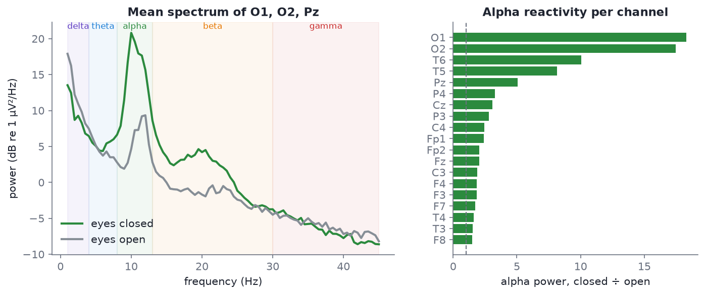
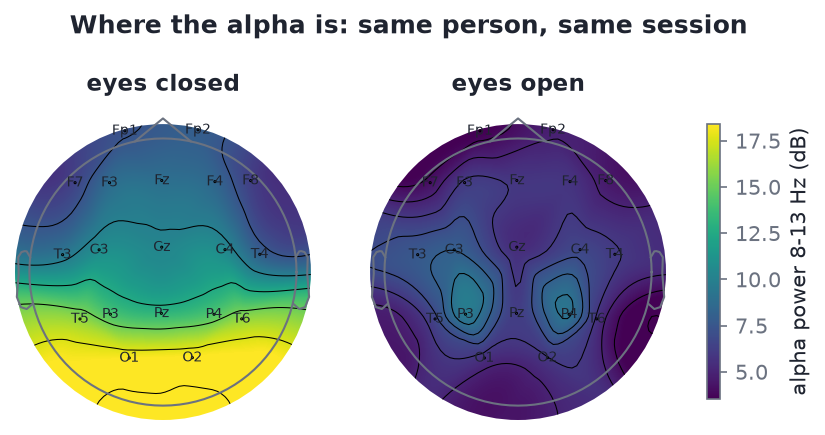

# Lab 1: find the alpha peak

The goal of this session is **one plot**: a power spectrum from a real recording that shows the alpha bump appear when the person closes their eyes. Along the way you will load an EDF, filter it, browse it, compute spectra, and draw a topomap. Budget 60-90 minutes; much of it is install and reading.

By the end you should have, in your notes file: the two spectra (eyes closed and open), a topomap of eyes-closed alpha, and screenshots of one blink and one muscle burst.

## Before you start

- Python environment set up as in [Module 00](00-start-here.md) (`pip install -r code/requirements.txt`).
- Read the MNE [Overview of MEG/EEG analysis](https://mne.tools/stable/auto_tutorials/intro/10_overview.html) tutorial, which walks one dataset from raw file to a plot in about 20 minutes. Bookmark the full [MNE tutorial index](https://mne.tools/stable/auto_tutorials/index.html); it is ordered so a new user can go top to bottom.
- Pair up if you can: one person types, the other reads the MNE docs.

## Part A: the course samples (main path)

You will use the resting-state pair from the [sample catalogue](../data/README.md): `s01` (eyes closed) and `s02` (eyes open), five minutes each, same person, same session, 19 channels.

### Step 1: run the finished script

There is a complete script for this lab. Run it first so you know what "working" looks like, then rebuild it step by step below.

```bash
python code/labs/lab1_alpha_peak.py            # saves plots to ./lab_outputs
python code/labs/lab1_alpha_peak.py --show     # also opens the interactive viewer and plots
```

The output should read:

```text
eyes closed: 19 channels, 250 Hz, 310 s
eyes open: 19 channels, 249 Hz, 308 s

Occipital (O1/O2) alpha peak: eyes closed 10.0 Hz, eyes open 12.0 Hz

Alpha power 8-13 Hz, eyes closed / eyes open (highest first):
    O1   18.3x
    O2   17.5x
    T6   10.0x
    T5    8.1x
    Pz    5.1x
    P4    3.3x
    Cz    3.1x
    P3    2.8x
    C4    2.4x
   Fp1    2.4x
   Fp2    2.0x
    Fz    2.0x
    C3    1.9x
    F4    1.9x
    F3    1.8x
    F7    1.7x
    T4    1.6x
    T3    1.5x
    F8    1.5x

Three channels with the most eyes-closed alpha power: O2, O1, T5
```

### Step 2: load and filter

Open a notebook or a fresh script in the `code/` folder:

```python
import mne
from eeg101 import load_sample

raw_closed = load_sample("rest_ec")      # s01, 310 s
raw_open = load_sample("rest_eo")        # s02, 308 s

for raw in (raw_closed, raw_open):
    print(raw.info["sfreq"], len(raw.ch_names), raw.times[-1])
    raw.filter(1.0, 40.0)                # band-pass 1-40 Hz
```

The **band-pass 1-40 Hz** removes the huge DC offset and slow drift below 1 Hz, and line noise and most muscle above 40 Hz. [Module 07](07-filtering.md) explains what that costs. Note the sampling rates: **250 and 249 Hz**. Never assume.

`load_sample` has already attached template 10-20 electrode positions (the "montage"). Without the helper you would write `raw.set_montage("standard_1020")` yourself (renamed `colin27_1020` in MNE 1.13+).

### Step 3: look at the raw trace

```python
raw_closed.plot(duration=10, n_channels=19, scalings=dict(eeg=50e-6))
```

Scroll (arrow keys) until you find a stretch where O1, O2 and Pz show a clear 10 Hz ripple. Screenshot it. Then open `raw_open.plot(...)` at the same scaling and compare the bottom rows.

### Step 4: compute and plot the spectra

```python
spec_closed = raw_closed.compute_psd(fmax=40)
spec_open = raw_open.compute_psd(fmax=40)
spec_open.plot()
spec_closed.plot()
```

`compute_psd` uses Welch's method by default ([Module 10](10-spectral-features.md) explains it). Each plot shows one line per channel.

**What you should see:** in the eyes-closed spectrum, a clear peak near **10 Hz**, largest on the occipital channels (O1, O2). In the eyes-open spectrum it is much smaller (here a small bump near 12 Hz). That is the **posterior alpha rhythm**, and it is the single most reliable thing in human EEG.



*The reference result, from `s01_rest_eyes-closed_19ch.edf` and `s02_rest_eyes-open_19ch.edf`. Your plots will look busier (one line per channel) but should show the same thing.*

### Step 5: the topomap

```python
spec_closed.plot_topomap(bands={"Alpha (8-13 Hz)": (8, 13)})
```

The alpha peak should be drawn at the back of the head. **If it is not at the back of the head, something is wrong with the montage** (positions or channel names). Calling `plot_topomap()` with no arguments draws all five bands at once; try that too.



*Reference topomaps from `s01` and `s02`, same colour scale.*

### Step 6: put a number on it

```python
import numpy as np

def alpha_power(spec):
    psd, freqs = spec.get_data(return_freqs=True)
    band = (freqs >= 8) & (freqs <= 13)
    return psd[:, band].mean(axis=1)               # mean 8-13 Hz power per channel

ratio = alpha_power(spec_closed) / alpha_power(spec_open)
for name, r in sorted(zip(raw_closed.ch_names, ratio), key=lambda x: -x[1])[:5]:
    print(f"{name}: {r:.1f}x")
```

Each spectrum is read with its own frequency axis because the two files have slightly different sampling rates (250 and 249 Hz), so their frequency bins do not line up exactly. Using one file's `freqs` to index the other fails with an `IndexError`, which is a good lesson in why `sfreq` matters. Expect O1 and O2 at the top at about 15x and 14x. The script reports 18.3x and 17.5x because it uses 2 s windows and median averaging, which is less swayed by the occasional artifact; the ranking is the same.

### Two things to try while you have it open

- **Find an eye blink and a stretch of muscle noise.** `s01` and `s02` have few; for a guaranteed blink load `load_sample("pipeline_raw")` (s06) and look at Fp1/Fp2 in the first 30 seconds; muscle bursts are on T3-T6 around 13-17 s. Screenshot one of each for your notes, and use them in your [artifact cheat sheet](05-artifacts-field-guide.md#exercise-your-one-page-cheat-sheet).
- **Change the band edges.** Recompute the ratio for 7-12 Hz and 9-14 Hz. How much does it change? This is why band edges are conventions ([Module 02](02-frequency-bands.md)).

## Part B: the PhysioNet version (extension)

This is the exact exercise from the original syllabus, on a public research dataset: two one-minute baseline runs from the [PhysioNet EEG Motor Movement/Imagery dataset](https://physionet.org/content/eegmmidb/1.0.0/) (64 channels, 160 Hz). **Run 1 is eyes open, run 2 is eyes closed.** It downloads about 2.5 MB the first time.

```python
import mne
from mne.datasets import eegbci

files = eegbci.load_data(subject=1, runs=[1, 2])   # 1 = eyes open, 2 = eyes closed
raw_open = mne.io.read_raw_edf(files[0], preload=True)
raw_closed = mne.io.read_raw_edf(files[1], preload=True)

for raw in (raw_open, raw_closed):
    eegbci.standardize(raw)                        # clean channel names
    raw.set_montage("standard_1005")               # attach 10-20 positions
    raw.filter(1.0, 40.0)                          # band-pass 1-40 Hz

raw_closed.plot(duration=10, n_channels=20)        # look at the raw trace
raw_open.compute_psd(fmax=40).plot()               # spectrum, eyes open
raw_closed.compute_psd(fmax=40).plot()             # spectrum, eyes closed
raw_closed.compute_psd(fmax=40).plot_topomap()     # alpha should be at the back
```

For subject 1, the occipital channels (O1, Oz, O2) peak at **10.0 Hz** with eyes closed, and their 8-13 Hz power is about **13 times** the eyes-open value. Try two or three other subjects (`subject=2`, `3`, ...): the peak frequency and the size of the effect vary from person to person, which is itself worth noting.

> [!NOTE]
> Compare the two datasets: research gel electrodes, 64 channels, 160 Hz in PhysioNet; dry electrodes, 19 channels, 250 Hz in the course samples. The alpha effect is clear in both. That robustness is exactly why eyes-closed alpha is the first thing to check on any new system.

If you prefer a textbook pace, Aaron Newman's free [Neural Data Science in Python](https://neuraldatascience.io) (Dalhousie) has an EEG chapter built on MNE with downloadable notebooks and a [YouTube playlist](https://www.youtube.com/playlist?list=PLtfEWMIgWS22MMZjPIzBRE2cHhMcvEKwp); it assumes no prior Python.

## What to collect for your notes file

- [ ] The eyes-closed and eyes-open spectra (screenshots or the saved `lab_outputs/lab1_spectra.png`).
- [ ] The eyes-closed alpha topomap.
- [ ] A screenshot of a 10-second stretch of eyes-closed alpha in the raw viewer.
- [ ] A screenshot of one eye blink.
- [ ] A screenshot of one muscle burst.
- [ ] One sentence: what is the alpha peak frequency, and which three channels have the most alpha?

## Troubleshooting

| Problem | Fix |
| --- | --- |
| `ModuleNotFoundError: No module named 'eeg101'` | Run Python from the `code/` folder, or add it to the path: `import sys; sys.path.insert(0, "code")` |
| `FileNotFoundError` for a sample | The helpers look in `data/samples/` relative to the repo; check you cloned the whole repo including the EDF files |
| The plot window does not appear, or appears and closes | In Jupyter run `%matplotlib qt` first. In a script, the viewer blocks until closed; with `--show` the lab script calls `plt.show()` at the end |
| `FutureWarning: Montage name 'standard_1020' is deprecated` | Harmless on MNE 1.13+; use `"colin27_1020"` to silence it. `eeg101` already picks the right name |
| The eyes-closed topomap peaks at the front | Montage or channel-name problem. Check `raw.ch_names` and that `set_montage` ran without "missing channel" warnings |
| `eegbci.load_data` fails | No internet or PhysioNet is down. Part A needs no download |
| The spectrum is dominated by a huge spike at 60 Hz | You skipped the 1-40 Hz filter, or ran it on a copy. `raw.filter()` changes the object in place and also returns it |
| Everything looks flat in the viewer | The scaling is too large: press `+`, or pass `scalings=dict(eeg=50e-6)` |

## Self-check

<details><summary>What is the alpha peak frequency in s01, and where is it largest?</summary>

10.0 Hz, largest at O2 and O1 (then T5). The eyes-closed / eyes-open alpha ratio is 18.3x at O1 and 17.5x at O2.

</details>

<details><summary>Why filter 1-40 Hz before computing the spectrum?</summary>

To remove the DC offset and slow drift below 1 Hz and line noise and most muscle above 40 Hz, so the spectrum shows brain rhythms rather than electrode and mains junk.

</details>

<details><summary>Your eyes-closed topomap shows alpha strongest at Fp1. Name two likely causes.</summary>

The electrode positions (montage) are wrong or not matched to the channel names; or channels are mislabelled in the file. Less likely, frontal artifact (slow eye movements) leaking into 8-13 Hz.

</details>

<details><summary>Why does the eyes-closed/eyes-open ratio fall to about 1.5-2x at frontal and anterior temporal channels?</summary>

There is little alpha there to begin with, so opening the eyes has little to block. Alpha and its reactivity are posterior.

</details>

## Next

Week 2 starts with [Module 07: Filtering](07-filtering.md). Lab 2 comes back to these recordings and cleans them properly.
