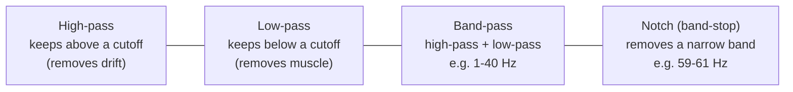
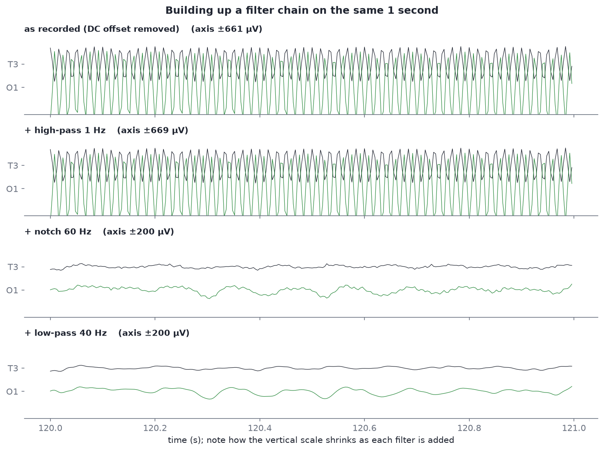
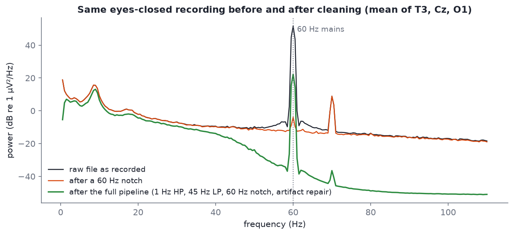
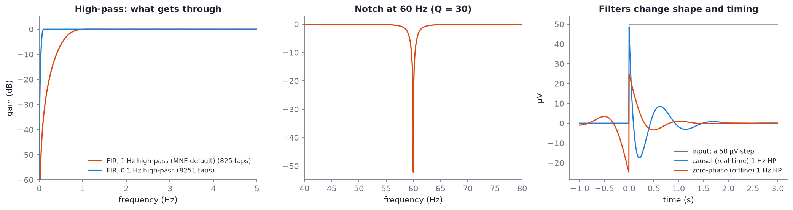

# Filtering

After this module you should be able to:

- say what a 1 Hz high-pass, a 40 Hz low-pass and a 60 Hz notch each remove, and why they are applied in that order;
- read a filter's frequency response and step response, and explain why "zero-phase" filtering is impossible in real time;
- measure line noise in a spectrum, in dB, before and after a notch;
- explain why filtering cannot separate brain activity from an artifact that occupies the same frequencies.

Filtering is the first step of nearly every EEG pipeline, including the Divergence platform's: **filter → re-reference → handle artifacts → compute features**. It is also the step people get wrong most often, because filters always work: they never throw an error, they just quietly change your data.

## Why filter at all

Raw EEG files contain three kinds of energy you almost never want:

| Problem | Frequency range | Where it comes from | Fix |
| --- | --- | --- | --- |
| DC offset and slow drift | 0 to about 0.5 Hz | electrode-skin chemistry, sweat, cable movement | **high-pass** at 0.5-1 Hz |
| Mains hum (line noise) | exactly 60 Hz in North America, 50 Hz in Europe and most of the rest of the world, plus harmonics (120, 180 Hz…) | power lines, lights, chargers, unshielded cables | **notch** at 60 Hz (or 50 Hz) |
| Muscle and high-frequency noise | broadband, mostly above 20-30 Hz | jaw, forehead, neck and temporal muscles; amplifier noise | **low-pass** at 40-45 Hz |

Toronto is on the North American grid, so recordings made there have **60 Hz** line noise. A recording from Europe would have 50 Hz. Always check the spectrum rather than assuming.

The course's raw files show how large these problems are. In `s03_linenoise_raw_19ch.edf` the median DC offset across channels is **15,872 µV**, against brain signals of 10-50 µV. That number comes from `code/labs/m07_filtering.py`; you will run it below.

## The four filter types



- **High-pass** at 1 Hz: lets through everything above about 1 Hz. Removes the DC offset and slow drift. 0.1-0.5 Hz is used when slow activity matters (sleep, ERPs); 1 Hz is standard before ICA.
- **Low-pass** at 40 or 45 Hz: lets through everything below the cutoff. Removes most muscle activity and everything near the mains frequency.
- **Band-pass**: both at once, written as "1-40 Hz". This is what the syllabus's first script does with `raw.filter(1.0, 40.0)`.
- **Notch**: removes a narrow band around one frequency. Only needed if you keep frequencies above the mains frequency, or if the hum is so large that even a low-pass leaves some behind (it often is).

## Watch it happen



*One second of `s03_linenoise_raw_19ch.edf` (T3 and O1). Note the vertical scale: ±661 µV in the top row, ±200 µV once the notch is applied.*

Read the rows top to bottom:

1. **As recorded** (offset subtracted for display): a solid wall of 60 Hz. You cannot see any brain activity at all.
2. **+ high-pass 1 Hz**: almost no visible change. The drift was not the main problem in this second; the hum was.
3. **+ notch 60 Hz**: the wall disappears and real EEG appears. O1 shows the irregular rhythm of eyes-closed alpha.
4. **+ low-pass 40 Hz**: the traces get smoother. The remaining high-frequency fuzz is gone.

## Measuring line noise in a spectrum

A time-domain plot tells you that something is wrong; a spectrum tells you exactly what and how much.



*Mean spectrum of T3, Cz and O1 in `s03_linenoise_raw_19ch.edf` (black: raw; orange: after MNE's 60 Hz notch) and `s04_linenoise_cleaned_19ch.edf` (green: the same recording after the platform's pipeline).*

Things to notice:

- **The 60 Hz spike** in the raw file reaches about 52 dB (re 1 µV²/Hz) while its neighbours sit near -10 dB. The script measures the peak at **61.6 dB above the neighbouring frequencies**. Decibels are logarithmic: every 10 dB is a factor of 10 in power, so 60 dB is a factor of one million.
- **The alpha peak near 9 Hz is untouched** by the notch. Notch filters are narrow; that is the point.
- **There is a second peak at 70 Hz**, about 22 dB above its neighbours. 70 is not a multiple of 60, so it is not mains. It most likely comes from the hardware itself. A 60 Hz notch does nothing to it (24 dB after notching), but a 40 or 45 Hz low-pass removes it along with everything else above the cutoff.
- **The platform-cleaned file (green) still has a 60 Hz peak**, at about 25 dB absolute. Its 45 Hz low-pass and notch together cut the hum by about 27 dB, which is a lot (a factor of about 500), but the hum started a million times larger than the EEG. No practical filter has infinite attenuation. MNE's notch, applied here offline, reaches about -3 dB. The lesson: **when the noise is enormous, check the spectrum after filtering instead of assuming the filter worked.**
- **The green curve falls away above 45 Hz**: that is the low-pass doing its job.

> [!NOTE]
> The relative "peak above neighbours" number is misleading for the cleaned file: its neighbours were also cut by the 45 Hz low-pass, so the peak still sticks out by 58.7 dB relative to them. Compare absolute power when two files were filtered differently.

## What filters cost

Filters are not free. Every filter trades sharpness in frequency against smearing in time.



*Filter designs at 250 Hz, drawn by `filter_responses()` in `code/figures/make_figures.py`. No sample file; these are the filters themselves.*

### Transition band and filter length

A real filter cannot jump from "pass" to "block" at exactly 1 Hz. The region in between is the **transition band**. MNE's default 1 Hz high-pass has a 1 Hz-wide transition band: full attenuation near 0 Hz, half amplitude (-6 dB) at 0.5 Hz, everything passed from 1 Hz up. MNE prints these details every time it filters; read them. The sharper you want the transition, the longer the filter has to be:

| High-pass cutoff | Taps at 250 Hz | Signal needed per output sample |
| --- | --- | --- |
| 1 Hz | 825 | 3.3 s |
| 0.1 Hz | 8,251 | 33.0 s |

*Numbers printed by `code/labs/m07_filtering.py`, from `mne.filter.create_filter`.*

Long filters cause **edge effects**: the first and last few seconds of a recording (or of any segment you filter on its own) are distorted because the filter runs out of data. Filter the whole continuous recording once, then cut it into pieces, never the other way round.

### FIR and IIR

- **FIR** (finite impulse response) filters, MNE's default, are stable and can be made exactly zero-phase. They are long.
- **IIR** (infinite impulse response) filters, such as Butterworth, are short and cheap, which is why real-time systems use them. They feed their output back into themselves, which makes them efficient but able to ring or become unstable if badly designed.

### Zero-phase and causal filtering

The step response panel (right) is the most important picture in this module. A 50 µV step goes in at time 0:

- The **causal** filter (blue) only uses past samples, as any real-time system must. Its output responds at the step and then **rings**: it overshoots to about -17 µV and oscillates for over a second.
- The **zero-phase** filter (orange) runs forwards and then backwards over the data. It introduces no time delay, but its output **starts changing before the step happens**, wobbling for most of the second beforehand. That is only possible because it can see the future, which is fine offline and impossible live.

Both have changed the shape of the signal. A filtered blink, spike or ERP component is not the same shape as the original, and a sharp filter can create ripples that look like oscillations. This is why filter settings must always be reported, and why "I filtered at 30 Hz and found a 28 Hz rhythm" deserves suspicion.

> [!IMPORTANT]
> **Neurofeedback must use causal filters.** Feedback is computed from the last second or so of signal while the person is still being recorded. There is no future data to run a filter backwards over. Causal filters add delay and phase distortion, so real-time band power always lags slightly behind what an offline analysis of the same data would show. When you compare a live session's numbers with an offline re-analysis, expect small differences for this reason alone.

## A filter cannot fix everything

A low-pass at 40 Hz removes muscle activity above 40 Hz. It does nothing to muscle activity at 20-40 Hz, which overlaps beta and low gamma. A high-pass at 1 Hz removes drift, but a blink (most of its energy below 4 Hz) passes straight through. Filtering separates signals by frequency. When an artifact and the brain share frequencies, you need a method that separates them by **space** (where on the scalp they appear) or by **statistics**, which is what ICA and ASR do in [Module 09](09-artifact-handling.md).

## When to resample

Resampling (changing the sampling rate) is a filtering operation: to go down to a lower rate you must first low-pass below the new Nyquist frequency (half the sampling rate) to avoid aliasing. MNE's `raw.resample()` does that for you. Reasons to do it:

- to make files from different devices match (the course samples run at 242-251 Hz);
- to speed up ICA or long analyses on high-rate data (for example 1000 Hz down to 250 Hz).

Do it after filtering the continuous data and before epoching. Do not resample data you intend to compare at frequencies close to the new Nyquist.

## Hands-on

Run the module script (from the repo root):

```bash
python code/labs/m07_filtering.py            # saves plots to ./lab_outputs
python code/labs/m07_filtering.py --show     # also opens them
```

It prints:

```text
sampling rate 250 Hz, Nyquist 125 Hz, 410 s
median DC offset across channels: 15,872 µV

60 Hz line noise (mean of T3, Cz, O1)   absolute power   above neighbours
  raw file                     52.4 dB          61.6 dB
  + 1 Hz high-pass             52.4 dB          61.5 dB
  + 60 Hz notch (MNE)          -3.1 dB           9.1 dB
  platform cleaned file        25.0 dB          58.7 dB
70 Hz peak in the raw file   22.2 dB (not mains: 70 is not a multiple of 60)
70 Hz after notching 60     24.0 dB (a 60 Hz notch does nothing to it)

1 Hz high-pass FIR: 825 taps = 3.3 s of signal per output sample
0.1 Hz high-pass FIR: 8251 taps = 33.0 s
```

The core of it, which you can type into a notebook yourself:

```python
from eeg101 import load_sample

raw = load_sample("linenoise_raw")
raw.compute_psd(fmax=120).plot()          # find the line noise before you filter

clean = raw.copy().filter(l_freq=1.0, h_freq=None)   # high-pass: drift and DC offset
clean.notch_filter(freqs=60)                          # mains (use 50 outside North America)
clean.filter(l_freq=None, h_freq=40.0)                # low-pass: muscle, 70 Hz device peak
clean.compute_psd(fmax=120).plot()
clean.plot(duration=10, n_channels=19)
```

Things to try:

1. Change the notch to `freqs=[60, 120]`. Does anything change at 120 Hz in this file? (The sampling rate is 250 Hz, so the spectrum stops at 125 Hz.)
2. Replace the high-pass with `l_freq=0.1`. Plot the first 10 seconds. What do the edges look like now?
3. Filter with `method="iir"` and compare the spectra with the FIR default. MNE's [Filtering and resampling tutorial](https://mne.tools/stable/auto_tutorials/preprocessing/30_filtering_resampling.html) walks through the same comparison.
4. Load `linenoise_cleaned` and plot it alongside your own result for the same 10 seconds. Where do they differ, and why might they? (Hint: the platform also repaired artifacts.)

## Go deeper

- MNE: [Filtering and resampling data](https://mne.tools/stable/auto_tutorials/preprocessing/30_filtering_resampling.html), and the longer [Background information on filtering](https://mne.tools/stable/auto_tutorials/preprocessing/25_background_filtering.html), which covers transition bands, causal vs non-causal filters and the step responses above in depth.
- Mike X Cohen's lectures on filtering in the [ANTS playlist](https://www.youtube.com/watch?v=ukjuFUghieg&list=PLn0OLiymPak0t1moK3sn4Sl1seXlEOPHT). Cohen is the clearest explainer of why the maths works.
- Widmann, Schröger and Maess (2015), [Digital filter design for electrophysiological data – a practical approach](https://doi.org/10.1016/j.jneumeth.2014.08.002), *Journal of Neuroscience Methods*: the standard reference on choosing filter settings.

## Check yourself

<details><summary>What does a 1 Hz high-pass remove, and why is it needed in these files?</summary>

Everything below about 1 Hz: the electrode's DC offset (about 15,900 µV in s03) and slow drift from sweat and movement. Without it the brain signal, tens of µV, is a tiny ripple on a huge, wandering baseline.
</details>

<details><summary>Why is a 60 Hz notch needed in Toronto, and what would you use in London?</summary>

North American mains power runs at 60 Hz, and the electrical hum couples into the electrodes and cables at exactly that frequency. In the UK and most of Europe the grid runs at 50 Hz, so the notch goes at 50 Hz.
</details>

<details><summary>After notching, s04 still shows a 60 Hz peak. Did the filter fail?</summary>

No. It attenuated the hum by roughly 27 dB, about a factor of 500 in power. But the hum started about 60 dB, a million times, above the EEG at neighbouring frequencies. Any finite attenuation leaves a residue when the noise is that large. The fix is better recording conditions (shielding, electrode contact, unplugging chargers) or a deeper notch, and always checking the spectrum afterwards.
</details>

<details><summary>Why can't a neurofeedback system use the same zero-phase filter as an offline analysis?</summary>

A zero-phase filter runs over the data forwards and then backwards, so each output sample depends on future samples. In real time the future has not been recorded yet. Live systems must use causal filters, which add delay and distort phase.
</details>

<details><summary>A muscle burst has most of its power at 25-45 Hz. Will a 40 Hz low-pass remove it?</summary>

Only the part above 40 Hz. The 25-40 Hz part overlaps the beta band and passes straight through. Separating it from brain activity needs a spatial or statistical method such as ICA or ASR (Module 09), or rejecting the segment.
</details>
