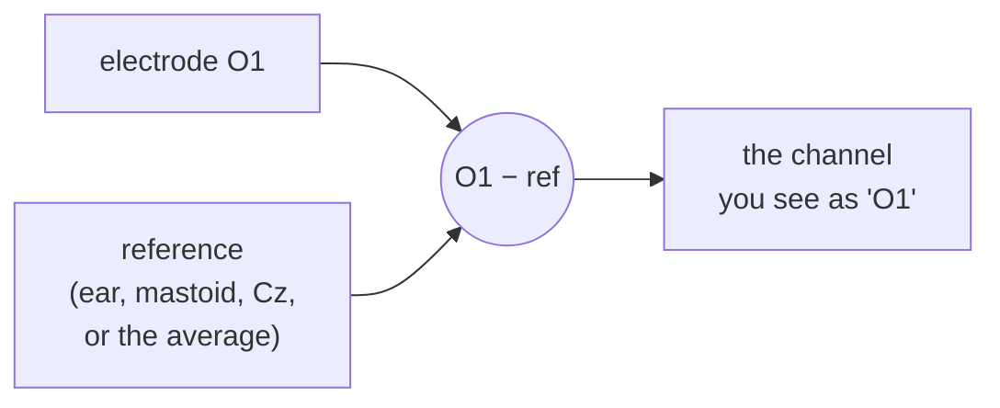
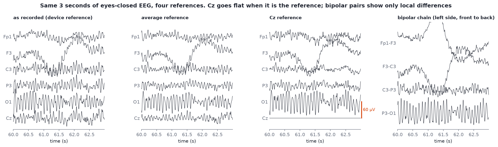

# Re-referencing

After this module you should be able to:

- explain why there is no such thing as the voltage "at" one electrode;
- describe average, linked-mastoid, Cz and bipolar references, and say which ones the course headsets allow;
- predict what a reference change will and will not do to a channel's alpha power;
- explain why average-referenced data loses one dimension, and what that means for ICA.

## Every channel is a difference

A voltmeter needs two leads. Each EEG channel is the voltage at one electrode **minus** the voltage at a reference point. If the reference picks up brain activity, blinks or noise, that activity appears, upside down, in every channel that uses it.

There is no electrically silent place on the head, so every choice of reference is a compromise. **Re-referencing** means recomputing all channels against a different reference after recording. Because subtraction is linear, you can do it at any time, as long as the original reference's channels were recorded or the new reference can be built from channels you have.



## The common references

| Reference | How it is built | Good for | Watch out for |
| --- | --- | --- | --- |
| **Device / recording reference** | whatever the amplifier used: often an ear clip, a mastoid or a forehead site, not stored as a channel | quick looks | differs between headsets, so files from different devices are not comparable until re-referenced |
| **Average reference** | subtract the mean of all channels from each channel at every sample | dense, whole-head montages; the default in much research and in MNE's ICA examples | with few channels or uneven coverage the "average" is biased toward wherever the electrodes are; a single bad channel contaminates every other channel |
| **Linked mastoids** (or linked ears) | subtract the mean of the two mastoid (M1, M2) or ear (A1, A2) channels | clinical and ERP traditions; comparing with older literature | needs mastoid or ear channels in the file. **None of the course headsets record them**, so you cannot compute this reference from our samples |
| **Cz** | subtract channel Cz | some device defaults | Cz becomes a flat line, and activity under Cz is subtracted from everything; central rhythms vanish nearby |
| **Bipolar** | each channel is the difference between two neighbouring electrodes, e.g. Fp1-F3, F3-C3 | locating sharp, local events (clinical EEG reading); some neurofeedback protocols use a bipolar pair | shows only the difference between neighbours, so activity shared by both is cancelled |
| **REST** (reference electrode standardization technique) | uses a head model to estimate a reference "at infinity" | research comparing reference-free estimates | needs electrode positions and a forward model; see `raw.set_eeg_reference("REST")` in MNE |

## See the same three seconds four ways



*Three seconds of `s01_rest_eyes-closed_19ch.edf` (from 60 s) under four references.*

What changes:

- **Cz reference**: Cz becomes a perfectly flat line, by definition. O1 alpha changes a little, because Cz's own activity is now mixed into every other channel.
- **Average reference**: posterior alpha now shows up, smaller and inverted, at the front of the head. Average reference forces the channels to sum to zero at every instant, so a big positive signal at the back must be balanced by negative signal somewhere else.
- **Bipolar chain**: P3-O1 and C3-P3 keep strong alpha because O1 and P3 differ; Fp1-F3 shows almost none, because neither site has much.

What does not change: the underlying brain activity, and the times at which things happen. A reference changes how the activity is distributed across channels, not when it occurs.

You can put numbers on this with the median-Welch alpha power (8-13 Hz, µV²/Hz) of `s01` from 10 to 300 s:

| Channel | Device reference | Average reference | Cz reference |
| --- | --- | --- | --- |
| O1 | 65.1 | 49.1 | 70.9 |
| Cz | 10.6 | 5.2 | 0.0 |
| Fp1 | 5.3 | 8.5 | 5.0 |
| T3 | 8.8 | 7.2 | 8.8 |

The bipolar P3-O1 pair gives 38.1 µV²/Hz. O1 stays the highest-alpha site under every reference, which is why the [Lab 2](12-lab-2-clean-and-measure.md) check "is alpha highest at the back?" is robust. Absolute values change by 30% or more, which is why **you can only compare band power between recordings that share a reference.**

> [!IMPORTANT]
> In neurofeedback the reference is part of the protocol. "Reward 15-18 Hz at Cz" means something different with a linked-ear reference than with an average reference, and Cz is meaningless if Cz *is* the reference. When you read or set up a protocol, write down the reference.

## Average reference and rank

After average referencing, the channels always sum to zero. For `s01` the largest absolute sum across all 19 channels after `set_eeg_reference("average")` is about 6 × 10⁻¹³ µV, i.e. zero to rounding error. That means any one channel can be computed from the other 18: the data has **18 independent dimensions, not 19**. MNE reports this as rank:

```python
import mne
from eeg101 import load_sample

raw = load_sample("rest_ec").filter(1, 40)
print(mne.compute_rank(raw))                                   # {'eeg': 19}
print(mne.compute_rank(raw.copy().set_eeg_reference("average")))  # {'eeg': 18}
print(mne.compute_rank(raw.copy().set_eeg_reference(["Cz"])))     # {'eeg': 18}
```

Why you care: **ICA cannot find more components than the data has dimensions.** On average-referenced 19-channel data, ask for at most 18 components (`ICA(n_components=18)` or fewer; the labs use 15). MNE handles this with a PCA step and warns you if you ask for too many. Interpolating a bad channel or re-referencing to a single channel also removes a dimension. EEGLAB users meet the same problem as "rank deficiency" warnings.

## Doing it in MNE

```python
import mne
from eeg101 import load_sample

raw = load_sample("rest_ec").filter(1.0, 40.0)

avg = raw.copy().set_eeg_reference("average")      # average reference
cz = raw.copy().set_eeg_reference(["Cz"])          # single channel
bip = mne.set_bipolar_reference(raw.copy(), anode=["Fp1", "F3", "C3", "P3"],
                                cathode=["F3", "C3", "P3", "O1"])  # bipolar chain

# With mastoid channels you would write: raw.set_eeg_reference(["M1", "M2"])
# The course files have no M1/M2, so this line would raise an error here.

avg.plot(duration=5)
```

Notes:

- `set_eeg_reference` modifies the object in place and returns it; use `.copy()` to keep the original.
- Mark bad channels (`raw.info["bads"] = ["T3"]`) **before** average referencing, so the bad channel is left out of the average.
- In MNE, `projection=True` adds the average reference as a projector instead of applying it immediately. You will see this in older tutorials.

Read MNE's [Setting the EEG reference](https://mne.tools/stable/auto_tutorials/preprocessing/55_setting_eeg_reference.html) tutorial next; it shows the same comparisons on a 60-channel dataset.

## Check yourself

<details><summary>Why can't you compute a linked-mastoid reference from the course samples?</summary>

Linked mastoids is the average of two channels placed on the mastoid bones behind the ears (M1, M2, or ear clips A1, A2). None of the course headsets record those as channels, and you cannot reconstruct a voltage at a site that was never measured.
</details>

<details><summary>You switch from device reference to average reference and Fp1 suddenly shows alpha. Did the frontal lobe start producing alpha?</summary>

No. Average reference forces all channels to sum to zero, so strong posterior alpha is redistributed, inverted and smaller, across the other channels. In s01 Fp1 alpha goes from 5.3 to 8.5 µV²/Hz purely from the reference change.
</details>

<details><summary>What does a Cz-referenced Cz channel look like, and why?</summary>

A flat line at zero: it is Cz minus Cz. Any protocol that rewards activity "at Cz" cannot use Cz as its reference.
</details>

<details><summary>How many ICA components can you ask for on 19-channel average-referenced data, and why?</summary>

At most 18. After average referencing the channels sum to zero, so one channel is fully determined by the others and the data has rank 18. ICA cannot unmix more sources than there are independent dimensions.
</details>
