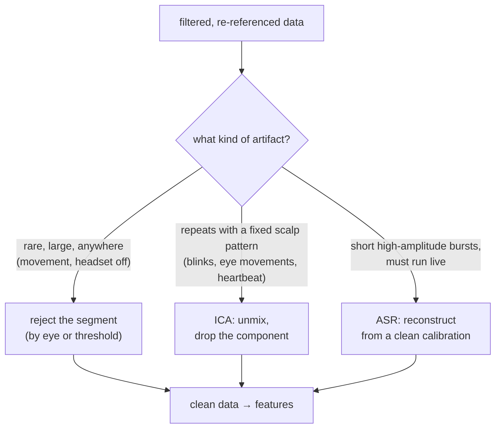
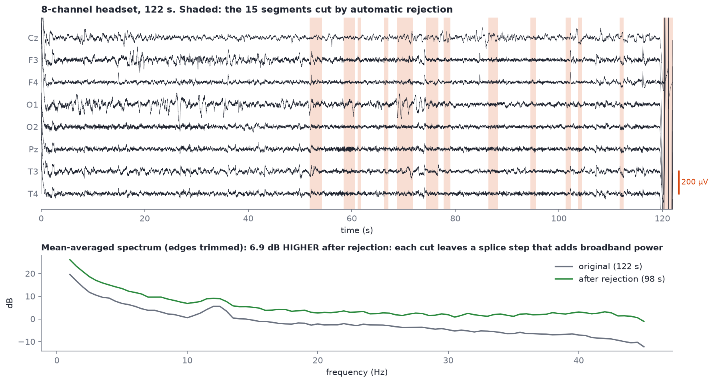
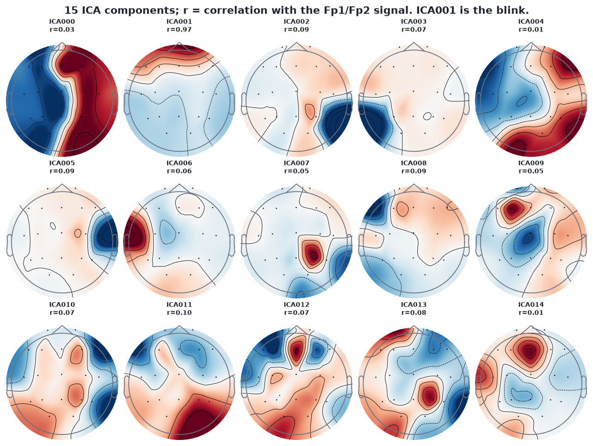
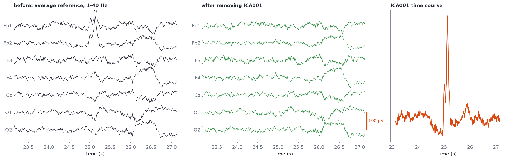
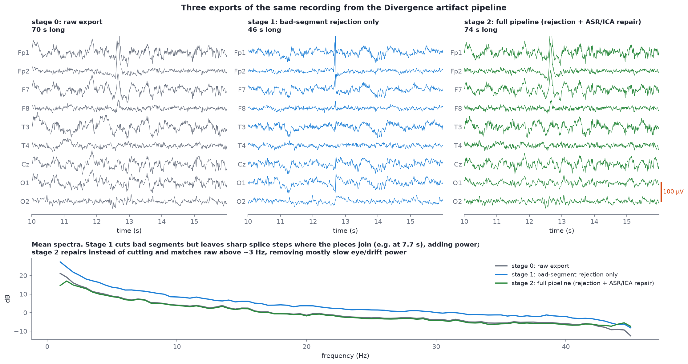

# Artifact handling: rejection, ICA and ASR

After this module you should be able to:

- describe the three families of artifact handling (reject, unmix, reconstruct) and when each one fits;
- run ICA on a real recording, find the blink component from its scalp map and time course, and remove it;
- explain how ASR works and why it is the usual choice for real-time systems;
- spot two traps in "cleaned" data: splices left by cutting, and junk the automatic tools missed.

[Module 05](05-artifacts-field-guide.md) taught you to recognise artifacts. [Module 07](07-filtering.md) showed that filters only separate signals by frequency, and blinks and muscle overlap the brain's frequencies. This module is about the tools that separate them some other way.



## Family 1: reject bad channels and bad segments

The oldest method and still the most honest: if a stretch of data is junk, do not analyse it.

- **Bad channels**: an electrode with poor contact, flat or far noisier than its neighbours. Mark it (`raw.info["bads"] = ["T3"]`) so it is left out of the average reference and of ICA, and optionally interpolate it from its neighbours later (`raw.interpolate_bads()`).
- **Bad segments**: mark time spans by eye in `raw.plot()` (press `a` to enter annotation mode and drag), or automatically with a peak-to-peak threshold. MNE treats any annotation whose description starts with `BAD_` as rejected, and `compute_psd`, `Epochs` and ICA skip it by default.

A threshold is a blunt but transparent tool. On `s06_pipeline_stage0_raw_19ch.edf`, filtered 1-40 Hz, marking any one-second window in which a channel swings more than 150 µV peak-to-peak flags **15 of 71 seconds**, mostly where the blinks are (output of `code/labs/m09_ica.py`).

```python
import numpy as np
from mne import Annotations
from eeg101 import load_sample

raw = load_sample("pipeline_raw").filter(1, 40)
sf = raw.info["sfreq"]
d = raw.get_data() * 1e6
n_sec = int(np.ceil(raw.times[-1]))          # include the final partial second!
bad = [s for s in range(n_sec) if np.ptp(d[:, int(s * sf): int((s + 1) * sf)], axis=1).max() > 150]
raw.set_annotations(Annotations(onset=bad, duration=[1.0] * len(bad), description=["BAD_threshold"] * len(bad)))
raw.plot()                                   # bad seconds are shaded red
```

### What automatic rejection looks like on a real file



*`s09_segments_original_8ch.edf` with the segments recorded in `s10_segments_removed_8ch.edf`'s annotations shaded.*

The platform's automatic rejection cut 15 segments, 0.7 to 3.1 s each, 24 s in total. Two lessons from the bottom panel:

1. **The rejection missed the biggest event, and its cuts made the spectrum worse.** Look at the far right of the top panel: the recording ends with a transient of about 82,000 µV peak-to-peak (the headset coming off). Both files still contain it, and with it left in, the two mean-averaged spectra are almost identical, because a mean is dominated by its single largest event. The figure trims that end (and the filter edge at the start) before comparing. Once it is gone, the cleaned file's spectrum sits about 7 dB *above* the original, not below: s10 was made by physically deleting the cut segments and gluing the pieces together, and every glue point is a step that adds broadband power. It is the same splice problem as s07 below.
2. **Rejection throws away data.** 24 of 122 seconds, 20%, is gone. With short recordings, that matters.

> [!WARNING]
> **Check the end of every recording.** Several course files (s05, s06, s09, s10) end with seconds of saturated junk where the headset was removed before recording stopped. In s06 the worst-channel peak-to-peak climbs from about 70 µV to 4,028, 108,419 and 391,783 µV over the last three seconds. One of those seconds can outweigh the rest of the file in any average.

## Family 2: ICA

**Independent component analysis** treats the recording as a mixture. Every electrode picks up a weighted sum of a few underlying sources: brain networks, the eyes, the heart, muscles. ICA estimates an "unmixing" matrix that turns the channels back into components that are as statistically independent as possible. Each component has:

- a **scalp map** (topography): how strongly it shows up at each electrode;
- a **time course**: what it does over time.

Blinks are ideal for ICA: they come from one place (the eyes, acting as a dipole: the cornea is positive relative to the retina), so they have a fixed scalp pattern, and they are big and frequent enough to dominate one component. Remove that component, mix the rest back together, and the blinks are gone while the brain activity under them stays.

### Components from a real recording



*ICA (15 components, `random_state=97`) on `s06_pipeline_stage0_raw_19ch.edf`, last 4.5 s cropped, 1-40 Hz, average reference. r = correlation of each component's time course with the mean of Fp1 and Fp2.*

**ICA001 is the blink.** Its map is strongly positive at the very front (Fp1, Fp2) and fades smoothly toward the back, and its time course correlates **r = 0.97** with the frontal channels. Every other component has |r| ≤ 0.10. MNE's automatic detector, `ica.find_bads_eog(raw, ch_name=["Fp1", "Fp2"])`, picks the same component, and ICLabel labels it "eye blink" with probability **0.98**.

> [!TIP]
> **Exercise: what is ICA000?** Its map splits the head into a negative left half and a positive right half. Before reading on, write down what you think it is. Then plot its time course with `ica.plot_sources(raw, picks=[0])` and its spectrum with `ica.plot_properties(raw, picks=[0])`.
>
> Things to weigh: a horizontal eye movement (looking left and right) produces opposite polarities at F7 and F8, the frontal-lateral sites nearest the eyes, with steps or square-ish waves in the time course. A whole-hemisphere split reaching back to the occipital sites is a less typical eye pattern; it can also come from the reference, from a lateral electrode problem, or from genuine brain activity. ICLabel calls it "brain" with probability 0.66. There is no answer key; the point is to practise combining the map, the time course and the spectrum before you remove anything. When unsure, **keep the component**.

### Before and after



*Four seconds of `s06` around a blink, before and after removing ICA001.*

The blink at about 25.1 s disappears from Fp1 and Fp2. The slower frontal swing at 26-26.7 s survives, because it was not part of the blink component (it may be an eye movement or drift). The occipital channels barely change. In numbers, from `code/labs/m09_ica.py`:

| Channel | SD before | SD after removing ICA001 |
| --- | --- | --- |
| Fp1 | 15.6 µV | 10.3 µV |
| Fp2 | 17.5 µV | 9.9 µV |
| O1 | 12.0 µV | 11.2 µV |

### Recipe and rules of thumb

```python
from mne.preprocessing import ICA
from eeg101 import load_sample

raw = load_sample("pipeline_raw")
raw.crop(0, raw.times[-1] - 4.5)      # drop the headset-off junk at the end
raw.filter(1.0, 40.0)                  # ICA is much more stable on data high-passed at ~1 Hz
raw.set_eeg_reference("average")

ica = ICA(n_components=15, random_state=97, max_iter="auto")
ica.fit(raw)
ica.plot_components()                  # find the frontal, symmetric map
ica.plot_sources(raw)                  # confirm it spikes at every blink
ica.exclude = [1]                      # the index you identified
clean = ica.apply(raw.copy())
```

- **Fit on 1 Hz high-passed data.** Slow drift breaks ICA's assumptions. A common trick is to fit ICA on a 1 Hz copy and apply the solution to a 0.1 Hz copy of the same recording.
- **Remove the junk first.** A single 100,000 µV transient will grab components for itself. Crop it or mark it `BAD_` (ICA skips `BAD_` annotations).
- **Ask for fewer components than channels.** At most the data's rank: 18 for 19 channels after average reference ([Module 08](08-re-referencing.md)).
- **Set `random_state`.** ICA starts from a random guess; fixing the seed makes your component numbers reproducible.
- **Remove as little as possible.** Usually one blink component, sometimes one horizontal eye movement and one heartbeat component. Removing "brain-looking" components to make the data prettier removes brain.

### ICLabel

[mne-icalabel](https://mne.tools/mne-icalabel/stable/index.html) is a Python port of EEGLAB's ICLabel classifier. It labels each component as brain, muscle artifact, eye blink, heart beat, line noise, channel noise or other, with a probability:

```python
from mne_icalabel import label_components   # pip install mne-icalabel onnxruntime

labels = label_components(raw, ica, method="iclabel")
for i, (lab, p) in enumerate(zip(labels["labels"], labels["y_pred_proba"])):
    print(f"ICA{i:03d} {lab:16s} {p:.2f}")
```

On s06 it returns `ICA001 eye blink 0.98`, and "other" for many components at probabilities between 0.35 and 0.89. ICLabel was trained on gel-electrode recordings with dozens of channels and expects average-referenced data filtered 1-100 Hz; on 19-channel dry-electrode data, treat its labels as a second opinion, not a verdict.

## Family 3: ASR (artifact subspace reconstruction)

ICA needs a few minutes of data and a human (or classifier) in the loop, so it is an offline tool. **ASR** is designed to run continuously, which is why it is the standard choice for real-time systems such as neurofeedback. It works like this:

1. **Calibrate.** Find a stretch of clean data, either a dedicated baseline recording or the cleanest windows of the recording itself, and compute its covariance: what normal variation across the channels looks like.
2. **Slide a short window** (typically about 0.5 s) along the data. In each window, run a principal component analysis (PCA) to find the directions of greatest variance.
3. **Compare with calibration.** Any component whose variance exceeds the calibration distribution by more than a cutoff of *k* standard deviations is flagged as artifact.
4. **Reconstruct.** Replace the flagged components with what the calibration data says the clean signal should be in that subspace, and transform back to channels. The rest of the window is untouched.

The cutoff *k* is the one setting that matters. Lower is more aggressive. EEGLAB's `clean_rawdata` plugin uses 20 by default in current versions; Chang et al. (2020) found 20-30 a good balance between removing artifacts and keeping brain activity. ASR is excellent at short, high-amplitude bursts (movement, muscle, electrode pops). It is less good at blinks, which are frequent and stereotyped; that is why pipelines often run ASR and then ICA.

Read the [clean_rawdata README](https://github.com/sccn/clean_rawdata) for how ASR is implemented in EEGLAB, and [mne-denoise's ASR page](https://mne.tools/mne-denoise/asr.html) for a Python implementation you can try on the course samples.

ASR was created by Christian Kothe, whose free lecture series [Introduction to Modern BCI Design](https://sccn.ucsd.edu/wiki/Introduction_To_Modern_Brain-Computer_Interface_Design) (SCCN/UCSD, ten recorded lectures with slide PDFs, no login) covers the signal processing it builds on, plus Lab Streaming Layer. If your project is the de-noising pipeline, those lectures and the [ASR/ICA validation branch](../project-branches.md) are your next reading.

## Putting it together: three exports of one recording



*`s06` (raw export, last 4.5 s cropped), `s07` (rejection only) and `s08` (full pipeline) from the Divergence artifact pipeline, 1-40 Hz.*

What to notice:

- **Stage 1 is shorter**: rejection kept 46 of 75 seconds. **Stage 2 is full length** (74 s): it repairs rather than cuts.
- **Stage 1's spectrum sits *above* the raw one.** That looks wrong until you look for splices. The rejection-only file has sample-to-sample jumps larger than 200 µV at 7.7, 12.7, 26.8 and 32.0 s: the places where the kept pieces were glued back together. Each glue point is a step, a step contains every frequency, and filtering a step makes it ring. The sharp spike at 12.7 s in the middle panel is one of these splices, not a blink.
- **Stage 2 and the raw data overlap above 4 Hz** and differ mainly in the lowest frequencies, where blinks and drift live. The full pipeline took the artifact energy out without removing the brain rhythms.

The same effect in numbers, mean delta (1-4 Hz) power over all channels, from `code/labs/m09_ica.py`:

| Version | Welch, mean of windows | Welch, median of windows |
| --- | --- | --- |
| raw (cropped, 1-40 Hz) | 207.2 µV² | 116.4 µV² |
| our ICA-cleaned (blink removed) | 88.0 µV² | 60.8 µV² |
| platform rejection only (s07) | 1104.2 µV² | 113.4 µV² |
| platform full pipeline (s08) | 104.4 µV² | 71.2 µV² |

Two morals. First, **cut data must be joined with care**: in MNE, mark segments `BAD_` instead of physically deleting them, so later steps treat each piece separately. Second, **median averaging is robust**: it shrugs off the splices that inflate the mean ten-fold. More on that in [Module 10](10-spectral-features.md).

## Hands-on

```bash
python code/labs/m09_ica.py
```

It prints the end-of-recording junk, the threshold rejection, the ICA blink component and its correlation, ICLabel's labels if installed, and the table above. Then:

1. Run `ica.plot_properties(raw, picks=[1])` on the blink component. Note the spectrum: most of its power is below 5 Hz.
2. Do the ICA000 exercise above.
3. Re-run ICA *without* cropping the last 4.5 s. Does the blink still get its own component?
4. Work through EEGLAB's [quick tutorial on rejection](https://sccn.ucsd.edu/wiki/A12:_Quick_Tutorial_on_Rejection) and MNE's [ICA tutorial](https://mne.tools/stable/auto_tutorials/preprocessing/40_artifact_correction_ica.html). EEGLAB is MATLAB, but the decisions are the same.

## Go deeper

- MNE: [Overview of artifact detection](https://mne.tools/stable/auto_tutorials/preprocessing/10_preprocessing_overview.html) and [Repairing artifacts with ICA](https://mne.tools/stable/auto_tutorials/preprocessing/40_artifact_correction_ica.html).
- The [Online EEGLAB Workshop](https://www.sccn.ucsd.edu/wiki/Online_EEGLAB_Workshop) videos on preprocessing and ICA, including Delorme's "Removing Artifactual Components".
- [clean_rawdata](https://github.com/sccn/clean_rawdata) (EEGLAB ASR) and [mne-denoise ASR](https://mne.tools/mne-denoise/asr.html) (Python).
- [mne-icalabel](https://mne.tools/mne-icalabel/stable/index.html).
- Christian Kothe, [Introduction to Modern BCI Design](https://sccn.ucsd.edu/wiki/Introduction_To_Modern_Brain-Computer_Interface_Design): lectures from the author of ASR.
- [Brainstorm](https://neuroimage.usc.edu/brainstorm/Tutorials/AllIntroduction)'s introduction tutorials do artifact rejection in a GUI, a good way to see the steps before scripting them.
- [Project branches: ASR/ICA validation](../project-branches.md), for how to measure whether a cleaning pipeline works.
- Chang, Hsu, Pion-Tonachini and Jung (2020), "Evaluation of artifact subspace reconstruction for automatic artifact components removal in multi-channel EEG recordings", *IEEE Transactions on Biomedical Engineering* 67(4).

## Check yourself

<details><summary>Why is a blink so easy for ICA to isolate?</summary>

It comes from a single source (the eyes) with a fixed scalp pattern, frontal and symmetric, and it is large and frequent, so one component can capture it almost entirely. In s06 the blink component correlates r = 0.97 with Fp1/Fp2.
</details>

<details><summary>Why do real-time systems use ASR rather than ICA?</summary>

ICA needs minutes of data to fit and a decision about which components to drop. ASR only needs a calibration covariance computed once; after that it processes each short window as it arrives, flagging and reconstructing the subspace that exceeds the calibration by more than k standard deviations.
</details>

<details><summary>The rejection-only export has more low-frequency power than the raw file. How?</summary>

Cutting out segments and gluing the rest together leaves steps at every splice (four in s07, at 7.7, 12.7, 26.8 and 32.0 s). Steps contain energy at all frequencies, mostly low ones, and the filter rings around them. A mean-averaged spectrum picks that up.
</details>

<details><summary>You fit ICA and three components each look like they hold one huge spike near the end of the file. What happened?</summary>

The recording contains a giant transient, probably the headset being removed, and ICA spent components modelling it. Crop or mark it `BAD_` and refit.
</details>

<details><summary>ASR's cutoff k: what happens if you set it to 5 instead of 20?</summary>

The algorithm becomes far more aggressive: normal brain variation exceeds 5 standard deviations often enough that ASR starts "repairing" genuine EEG. Chang et al. (2020) recommend 20-30.
</details>
