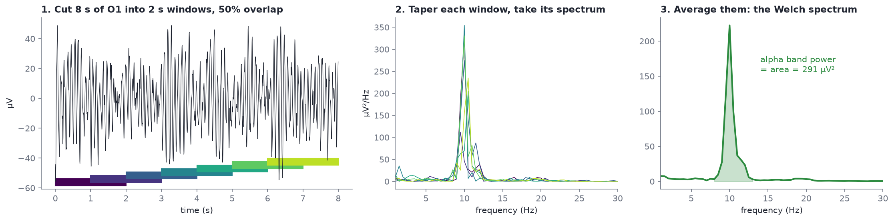
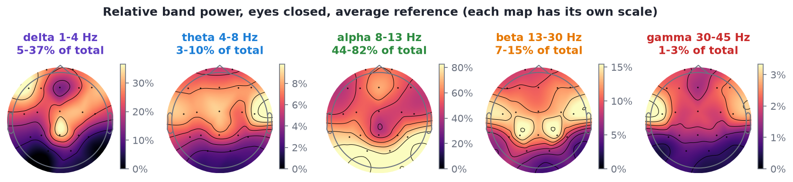
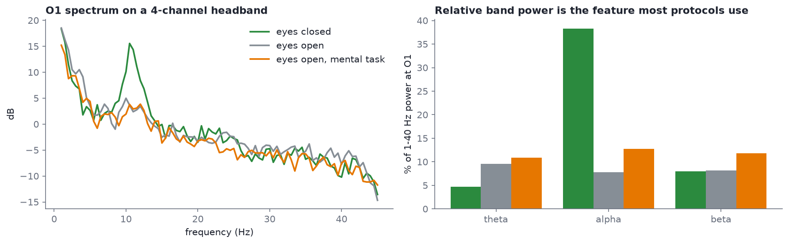

# Spectral features

After this module you should be able to:

- explain Welch's method in three steps and say what each setting controls;
- compute absolute band power, relative band power and a band ratio, and say which one a given protocol needs;
- read a spectrum in dB and spot the 1/f background, the alpha peak and line noise;
- choose median instead of mean averaging when a recording has artifacts, and say why.

Band power is the bridge between "I can see alpha" and neurofeedback. Nearly every protocol rewards or inhibits the power in some band at some site, so this is the feature you will compute most.

## Welch's method

A single Fourier transform of a long recording gives a noisy spectrum. **Welch's method** trades frequency detail for stability:



*Eight seconds of O1 from `s01_rest_eyes-closed_19ch.edf`, 1-45 Hz.*

1. **Cut** the signal into overlapping windows, here 2 s long with 50% overlap.
2. **Taper** each window (a Hann window fades the edges to zero, which reduces spectral leakage) and take its spectrum (a periodogram).
3. **Average** the spectra.

The settings and what they buy you:

| Setting | Effect |
| --- | --- |
| Window length | sets frequency resolution: resolution = 1 / window length, so a 2 s window gives 0.5 Hz bins. Longer windows resolve finer detail but give fewer windows to average |
| Overlap | 50% is standard; it recovers data the taper would otherwise down-weight |
| Averaging | `mean` (default) or `median`. See below |

In MNE: `raw.compute_psd(method="welch", fmin=1, fmax=40, n_fft=int(2 * raw.info["sfreq"]))`. The syllabus's script uses `n_fft` defaults, which is fine for a first look.

## Band power: absolute, relative, ratio

The area under the spectrum between two frequencies is the **absolute band power**, in µV². In the figure above, the shaded alpha area is 291 µV² for those 8 seconds.

**Relative band power** divides by the total power over a broad range (here 1-40 Hz). It is unitless, usually given as a percentage, and partly cancels differences that affect all frequencies equally, such as electrode impedance, skull thickness or amplifier gain. This is why many protocols use relative power.

**Ratios** compare two bands directly, e.g. theta/beta. They also cancel overall scale, but they double the ways a number can move: a ratio rises if the top goes up *or* the bottom goes down.

From `code/labs/m10_band_power.py`, O1 in the resting-state pair (median Welch, 2 s windows):

| Band | Eyes closed: absolute | Eyes closed: relative | Eyes open: absolute | Eyes open: relative |
| --- | --- | --- | --- | --- |
| delta 1-4 Hz | 20.3 µV² | 4.6% | 45.3 µV² | 47.3% |
| theta 4-8 Hz | 12.8 µV² | 2.9% | 11.3 µV² | 11.8% |
| alpha 8-13 Hz | 363.0 µV² | 83.0% | 19.1 µV² | 19.9% |
| beta 13-30 Hz | 37.8 µV² | 8.6% | 15.6 µV² | 16.3% |

Notice that eyes-open delta is 47% of total. That is not deep sleep; it is eye movements and blinks (most of their energy is below 4 Hz) in a recording where the eyes are open. Relative power is only as clean as the data under it.

### Where each band lives



*Relative power per band, `s01` eyes closed, average reference. Each map has its own colour scale.*

With eyes closed, alpha is 44-82% of total power depending on the channel, highest at the back. Delta (5-37%) is highest at the front, where eye movements land. Gamma (1-3%) is tiny everywhere; above 30 Hz, scalp EEG is hard to separate from muscle.

### The same feature on a 4-channel headband



*`s11_4ch_eyes-closed.edf`, `s12_4ch_eyes-open.edf`, `s13_4ch_eyes-open_task.edf`, channel O1.*

| Condition | theta | alpha | beta |
| --- | --- | --- | --- |
| eyes closed | 4.7% | 38.3% | 8.0% |
| eyes open | 9.5% | 7.8% | 8.2% |
| eyes open, mental task | 10.9% | 12.8% | 11.8% |

Four electrodes are enough to see alpha reactivity at O1. The task condition shows slightly higher beta than plain eyes open; with under a minute per condition from one person, that is a hint, not a finding.

## Theta/beta and other ratios

The theta/beta ratio (TBR) at Cz is the best-known ratio in neurofeedback, historically associated with attention. From the resting pair:

- eyes closed, Cz: TBR = 0.79
- eyes open, Cz: TBR = 1.40

The same person, minutes apart, and the ratio nearly doubles with eye state alone. Caveats for any ratio:

- It depends on eye state, drowsiness, age, reference and band edges, so only compare ratios measured the same way.
- Blinks and eye movements put power into theta; muscle puts power into beta. Either can move the ratio without the brain changing. ([Module 13](13-neurofeedback-loop.md) shows this in a feedback loop.)
- Large studies have questioned TBR as a diagnostic marker for ADHD (see Arns, Conners and Kraemer, 2013, *Journal of Attention Disorders*, "A decade of EEG theta/beta ratio research in ADHD: a meta-analysis"). Use it as a feature, not a diagnosis.

## Peak alpha frequency

The frequency of the alpha peak varies between people (roughly 8-12 Hz in adults) and slows with drowsiness and age. For `s01` with eyes closed, the peak over O1, O2 and Pz is **10.0 Hz**. The [alpha zoom figure](../assets/figures/alpha_zoom.png) from [Module 04](04-reading-a-raw-trace.md) shows the same thing in the time domain: about 10 peaks per second.

With eyes open, the same search returns 12.0 Hz, but look at the spectrum before believing it: when alpha is suppressed there is no clear peak, and "the biggest value between 7 and 14 Hz" is just noise. A peak frequency needs a peak.

Some protocols individualise band edges around the peak alpha frequency (for example "upper alpha = PAF to PAF + 2 Hz") rather than using fixed 8-13 Hz edges.

## The 1/f background

Every EEG spectrum slopes downward: power falls roughly as 1/f^χ with frequency. This **aperiodic** component sits under the rhythmic peaks, and part of what looks like "more theta" or "less beta" can be a change in the slope rather than in any rhythm. If you go further into spectral analysis, read about separating the two with **specparam** (formerly FOOOF): Donoghue et al. (2020), "Parameterizing neural power spectra into periodic and aperiodic components", *Nature Neuroscience* 23, and the [specparam documentation](https://specparam-tools.github.io/).

## Median beats mean when there are artifacts

Welch averages many windows. If one window contains a huge artifact, the **mean** is dragged up by it; the **median** ignores it as long as most windows are clean.

From `code/labs/m10_band_power.py`, Fp1 delta power in `s06_pipeline_stage0_raw_19ch.edf` (deliberately *not* cropped, so the headset-off junk at the end is included):

| Averaging | Fp1 delta power |
| --- | --- |
| `average="mean"` | 298,316.6 µV² |
| `average="median"` | 239.2 µV² |

A factor of more than 1,000 from a few seconds of junk. Median averaging is a good default for resting-state band power. It is not a substitute for looking at the data and rejecting what is bad ([Lab 2](12-lab-2-clean-and-measure.md) shows a case where you need both).

## Hands-on

```bash
python code/labs/m10_band_power.py
```

The core computation, as in the syllabus's Week 2 script:

```python
from eeg101 import load_sample

raw = load_sample("rest_ec").filter(1.0, 40.0)
spec = raw.compute_psd(method="welch", fmin=1, fmax=40, n_fft=int(2 * raw.info["sfreq"]), average="median")
psd, freqs = spec.get_data(return_freqs=True)          # psd in V²/Hz, shape (channels, freqs)
psd_uv = psd * 1e12                                     # µV²/Hz
df = freqs[1] - freqs[0]

alpha = psd_uv[:, (freqs >= 8) & (freqs < 13)].sum(axis=1) * df     # absolute, µV²
total = psd_uv.sum(axis=1) * df
relative_alpha = alpha / total
print(dict(zip(raw.ch_names, (relative_alpha * 100).round(1))))

spec.plot()                     # all channels
spec.plot_topomap()             # standard bands on head maps
```

Try:

1. Change `n_fft` to `int(4 * sfreq)` and to `int(0.5 * sfreq)`. How does the alpha peak's shape change?
2. Compute relative alpha for the eyes-open file and list the channels where it drops most.
3. Compute theta/beta at Cz for the three headband conditions. (The headband has Cz.)

MNE's [Spectrum class tutorial](https://mne.tools/stable/auto_tutorials/time-freq/10_spectrum_class.html) covers the `Spectrum` object in depth. For why the maths works, watch Mike X Cohen's "Static spectral analysis" lectures in the [ANTS playlist](https://www.youtube.com/watch?v=ukjuFUghieg&list=PLn0OLiymPak0t1moK3sn4Sl1seXlEOPHT), and work through notebooks 3-4 of Kramer and Eden's [Python for the practicing neuroscientist](https://elifesciences.org/labs/f779833b/python-for-the-practicing-neuroscientist-an-online-educational-resource), which derive spectral analysis of EEG rhythms from first principles.

## Check yourself

<details><summary>You want 0.25 Hz frequency resolution. How long must each Welch window be?</summary>

Resolution = 1 / window length, so 4 seconds.
</details>

<details><summary>Why do many neurofeedback protocols use relative rather than absolute band power?</summary>

Relative power divides by total power, which cancels factors that scale all frequencies together: electrode contact, skull thickness, amplifier gain. That makes sessions and people more comparable. The cost is that a change in any other band moves it too.
</details>

<details><summary>Eyes-open O1 shows 47% of its power in delta. Is the person asleep?</summary>

No. With eyes open, blinks and eye movements add large slow waves, mostly below 4 Hz, which spread back to O1. The relative delta is artifact, not slow-wave sleep.
</details>

<details><summary>When would you choose average="median" for Welch, and when would you still need to reject data?</summary>

Median when a minority of windows contain artifacts: it ignores outliers (Fp1 delta in s06 drops from about 298,000 to 239 µV²). You still need rejection when artifacts are frequent enough to affect more than half the windows at some channel, or when the artifact is in every window, such as continuous muscle tension.
</details>
