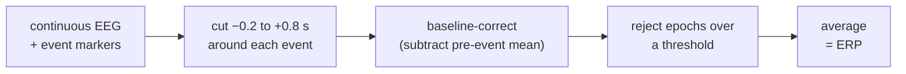
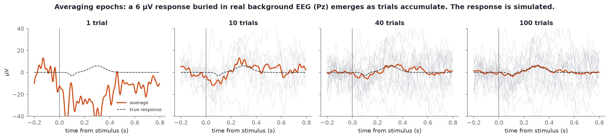

# Epochs and ERPs

After this module you should be able to:

- define an epoch, a baseline and a rejection threshold, and make epochs in MNE;
- explain why averaging reveals a response that is invisible in single trials, and how fast the noise falls;
- recognise the names of the common ERP components when you meet them in papers.

You will not need ERPs for the Divergence projects, which work with continuous band power. But the vocabulary is everywhere in EEG papers and tools, and epochs are also how continuous recordings get chopped into windows for band-power analysis.

## Epochs

An **epoch** is a fixed-length window of data cut out around an **event**: a stimulus, a button press, a tone, or just a regular tick. Each epoch has the same timing relative to its event, for example from 200 ms before to 800 ms after.



- **Baseline correction**: subtract each epoch's mean over the pre-event period (e.g. −200 to 0 ms) from the whole epoch, so every trial starts at zero and slow offsets do not add up.
- **Rejection threshold**: drop any epoch where a channel's peak-to-peak amplitude exceeds a limit, often 100-150 µV. This removes most trials with blinks and movement.

The same tools work without events. **Fixed-length epochs** chop a resting recording into equal windows, which is often how band power is computed per window:

```python
import mne
from eeg101 import load_sample

raw = load_sample("rest_eo").filter(1.0, 40.0)
epochs = mne.make_fixed_length_epochs(raw, duration=2.0, preload=True)
print(len(epochs))                               # 154 two-second epochs
epochs.drop_bad(reject=dict(eeg=150e-6))         # thresholds are in volts: 150 µV
print(len(epochs))                               # 101 kept
epochs.plot_drop_log()                           # which channels caused the drops
```

On the eyes-open sample, a 150 µV threshold drops 53 of 154 epochs (34%). The channels responsible most often are Fp1 (20), Pz (20), Fp2 (18) and F8 (12): blinks and eye movements at the front, plus a noisy Pz. That is a lot of data to lose, and it is why the ICA blink removal in [Module 09](09-artifact-handling.md) is usually done *before* epoching, so the blink epochs can be kept.

## Why averaging works

An event-related potential (ERP) is a small voltage change, a few µV, time-locked to an event. The ongoing EEG around it is tens of µV and is *not* time-locked. Average many epochs and the time-locked part stays the same while the rest averages toward zero.



*The background is real: random one-second stretches of Pz from `s02_rest_eyes-open_19ch.edf`, 1-30 Hz, baseline-corrected, with epochs over 80 µV peak-to-peak dropped. The response (dashed line, a small negative dip at 100 ms and a 6 µV positive peak at 300 ms) is **simulated** and added to every epoch.*

With one trial the response is invisible. By 10 it is suggested, by 40 it is recognisable, and by 100 the average lies close to the true response.

The rule behind this: if the background is random and independent across trials, the noise left in the average shrinks as **1 / √N**. Four times as many trials halves the noise. Going from 10 to 40 trials helps as much as going from 40 to 160. This is why ERP studies run dozens to hundreds of trials per condition, and why rejecting too many epochs hurts.

## ERP component vocabulary

ERP components are named by polarity (P positive, N negative) and either their order or their approximate latency in ms. The common ones:

| Component | Latency | What evokes it | Typical site |
| --- | --- | --- | --- |
| **P1** (P100) | ~100 ms | any visual stimulus; larger with attention | occipital |
| **N1** (N100) | ~100 ms (auditory), ~150-200 ms (visual) | stimulus onset; larger with attention | central (auditory), occipito-temporal (visual) |
| **MMN** (mismatch negativity) | ~150-250 ms | a sound that deviates from a repeated pattern, even when ignored | fronto-central |
| **P300** (P3) | ~300-600 ms | a rare, task-relevant target ("oddball") | parietal (P3b) |
| **N400** | ~400 ms | a word or picture that does not fit its context ("I take my coffee with cream and *dog*") | centro-parietal |

Latencies vary by task and person; treat them as rough guides.

## Hands-on

The epoch code above runs on the course samples. To try a real ERP, MNE's sample datasets include auditory and visual stimuli with event markers; the MNE [epochs tutorial](https://mne.tools/stable/auto_tutorials/epochs/10_epochs_overview.html) walks through events, `Epochs`, baseline and rejection, and then evoked responses.

For a complete experiment-to-ERP pipeline without hardware, try [EEG-ExPy](https://github.com/NeuroTechX/eeg-expy) (NeuroTechX, formerly eeg-notebooks; no login). It packages classic experiments (visual N170, P300, SSVEP, alpha) built on BrainFlow, PsychoPy and MNE, and its [documentation](https://neurotechx.github.io/EEG-ExPy/) has analysis examples that run on bundled datasets. Open the P300 or N170 example and find the three steps from this module in its code: epoching around the stimulus events, baseline correction, and the rejection threshold.

## Go deeper

- [Introduction to ERPs](https://erpinfo.org/the-erp-boot-camp), the free online course from Luck and Kappenman's ERP Boot Camp (3-5 hours). Only if your project needs event-related analysis. Free, but it needs an account on their course site.
- MNE: [The Epochs data structure](https://mne.tools/stable/auto_tutorials/epochs/10_epochs_overview.html).
- Steven Luck, *An Introduction to the Event-Related Potential Technique* (MIT Press, 2nd ed. 2014), the standard textbook (not free).

## Check yourself

<details><summary>Why baseline-correct each epoch?</summary>

Each epoch starts at a different voltage because of slow drift and ongoing activity. Subtracting the pre-event mean makes every epoch start at zero, so the average shows the change caused by the event rather than leftover offsets.
</details>

<details><summary>You have 25 clean trials and the noise in your ERP is 4 µV. How many trials do you need to get it down to 2 µV?</summary>

Noise falls as 1/√N, so halving it needs four times as many trials: 100.
</details>

<details><summary>A 150 µV threshold drops a third of the eyes-open epochs, mostly because of Fp1 and Fp2. What could you do instead of losing them?</summary>

Remove the blink component with ICA on the continuous data first, then epoch. The blink-contaminated epochs can then be kept, because the blinks are gone from them.
</details>

<details><summary>What does "P300" tell you about a component?</summary>

It is a positive deflection peaking roughly 300 ms after the event (in practice often 300-600 ms), typically largest over parietal sites, and evoked by rare, task-relevant targets.
</details>
