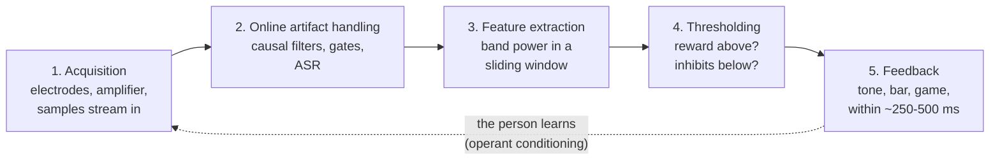
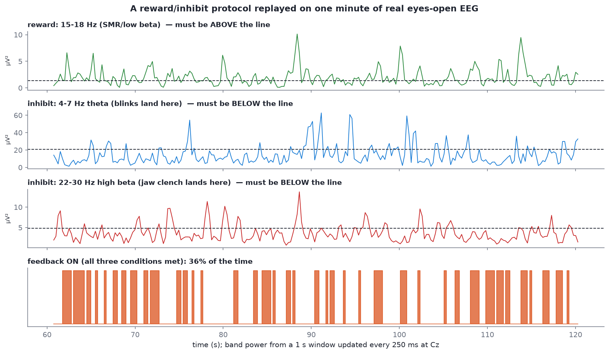

# The neurofeedback loop

After this module you will be able to:

- draw the five-step neurofeedback loop from memory and say what can go wrong at each step;
- read a protocol such as "Cz, reward 15-18 Hz, inhibit 4-7 Hz and 22-30 Hz" and say exactly when the feedback turns on;
- explain why thresholds adapt, and what "operant conditioning on a brain state" means;
- explain why artifacts matter twice as much in real time as they do offline.

Everything you have done so far (filtering, referencing, artifact handling, band power) feeds one loop: **measure a signal, compute a feature from it in real time, and show the person whether that feature is moving the right way.** When the signal is EEG, that loop is neurofeedback. When it is heart rhythm, it is biofeedback ([Module 14](14-hrv-basics.md)). Divergence runs both.

## The loop



1. **Acquisition.** Samples arrive in small blocks, a few times per second. Unlike Lab 1, you never have the whole recording; you only have the past.
2. **Online artifact handling.** The same families as [Module 09](09-artifact-handling.md), but only the ones that work causally: amplitude gates, online ASR, pre-trained ICA filters. Anything that needs the future (zero-phase filtering, fitting ICA on the whole session) is off the table.
3. **Feature extraction.** Usually band power in a sliding window, exactly as in [Module 10](10-spectral-features.md), recomputed every 100-250 ms over the last 0.5-2 s.
4. **Thresholding.** Compare each feature to its threshold.
5. **Feedback.** If the conditions are met, the person gets a reward: a tone, a bar going up, a game moving forward, a video getting brighter.

The dotted line is the point of it all. The person cannot feel their 15 Hz power directly, but the brain is good at repeating whatever gets rewarded. Over sessions, the state that produces the reward becomes easier to reach. That is **operant conditioning** on a brain state.

## Protocols: site, bands, thresholds

A protocol names four things:

| Part | Example | Meaning |
| --- | --- | --- |
| Site | Cz | Which electrode (or pair) the feature is computed from. See [Module 03](03-electrodes-and-montages.md). |
| Reward band | 15-18 Hz (SMR / low beta) | Feedback needs this **above** its threshold. |
| Inhibit bands | 4-7 Hz theta, 22-30 Hz high beta | Feedback needs these **below** their thresholds. |
| Thresholds | one per band | Set from a baseline, then adjusted during the session. |

Feedback is given when the reward band is above threshold **and** every inhibit band is below its threshold. The inhibit bands are partly about the brain and partly a safety net: theta is where blinks and drowsiness land, and high beta is where muscle tension lands.

### Adaptive thresholds

If thresholds stay fixed, a person either fails all the time (and gives up) or succeeds all the time (and learns nothing). So the threshold **adapts** so the person succeeds a target fraction of the time, commonly somewhere between 30% and 80% depending on the protocol and the stage of training. As the person gets better, the bar moves.

> [!NOTE]
> The exact target percentage and how fast the threshold moves are design choices, not laws. Different systems and clinicians use different values. Ask Alex what Divergence uses.

## A protocol replayed on real data

To make this concrete, the figure below replays a protocol on one minute of the eyes-open recording. Every 250 ms the code takes the last 1 second at Cz, computes band power in the three bands, and checks the three conditions. Thresholds are set from that same minute: reward at its 40th percentile, inhibits at their 80th.


*Sample `s02_rest_eyes-open_19ch.edf`, Cz, 60-120 s. Drawn by `neurofeedback_simulation()` in `code/figures/make_figures.py`.*

Read it from top to bottom. The reward trace (green) has to be above its line, the two inhibit traces have to be below theirs, and the bottom row is on only when all three agree. With these thresholds the feedback is on **36% of the time**. Notice how spiky the band-power traces are: a 1-second window is short, so the feature is noisy. Real systems smooth it, and that smoothing adds latency (see below).

## Why artifacts matter twice as much here

Offline, an artifact you miss makes your average a bit worse. Online, it **drives the feedback**:

- a **blink** dumps a big slow wave into the window, so theta power shoots up, the theta inhibit trips, and the feedback switches off;
- a **jaw clench** adds muscle activity from about 20 Hz up, so high beta trips;
- worse, if an artifact happens to land in the reward band, the person gets rewarded for clenching their jaw, and the conditioning learns the wrong thing.

The lab script injects fake blinks and jaw clenches into the same minute and replays the protocol:

```text
condition                  feedback ON  theta>thr  hibeta>thr  paused  ON of scored
clean recording                    35%        20%         20%      0%           35%
+ a blink every 4 s                27%        38%         20%     28%           37%
+ a jaw clench every 7 s           27%        21%         36%     22%           34%
```

Blinks nearly double the time theta spends above threshold (20% → 38%), and jaw clenches do the same to high beta (20% → 36%). Either way the person is told they are failing about a quarter more often, for reasons that have nothing to do with the brain state being trained. Add two simple gates (pause when the 1 s window is larger than about 114 µV peak to peak, or when 30-40 Hz power is far above baseline) and those windows are **paused instead of scored**, so the success rate over the scored windows comes back to about where it was. That is the reason the Divergence team cares so much about online artifact detection.

> [!IMPORTANT]
> A gate should pause the feedback, not count as a failure. Punishing someone for a blink teaches them nothing useful about their brain.

## Causal filtering and latency

In [Module 07](07-filtering.md) you used zero-phase filters, which look at samples on both sides of each point. In real time there is no "after", so online systems use **causal** filters that only look backwards. The price is a delay and some phase distortion (the step response in the filtering figure shows both).

Latency adds up from several places: the filter, the window length (a 1 s window describes the last second, centred half a second ago), any smoothing, and the display. Feedback needs to arrive quickly enough that the brain links it to the state that caused it; delays of a few hundred milliseconds are typical. Longer windows give steadier features but slower, blurrier feedback. Every protocol is a trade-off between the two.

## Reading: Enriquez-Geppert, Huster and Herrmann (2017)

Read the first half of [EEG-Neurofeedback as a Tool to Modulate Cognition and Behavior: A Review Tutorial](https://pmc.ncbi.nlm.nih.gov/articles/PMC5319996/) (open access, about 60 minutes). It is written for exactly your position: someone who knows some EEG and needs to understand how a neurofeedback study and system are built.

How to read it:

- **Start with Figure 2.** It is the whole field on one page: signal acquisition, online artifact handling, feature extraction, thresholding, and feedback. Compare it with the diagram above and note anything they include that we did not.
- **Then read the sections on feature selection and feedback design.** Write down every design choice they mention (window length, update rate, feedback modality, threshold rule, number and length of sessions).
- **Skim the rest** for the vocabulary of training studies: control groups, sham feedback, learners vs non-learners, transfer.
- Bring one question about the paper to the first meeting.

## Try it

```bash
python code/labs/m13_neurofeedback_replay.py
```

Then change one thing at a time in the script and re-run:

1. Move the reward threshold from the 40th to the 60th percentile. How much does the success rate drop?
2. Change `SITE` from `"Cz"` to `"O1"` and the reward band to alpha (8-12 Hz). This is an alpha-up protocol on the back of the head. Does the clean success rate change?
3. Make the window 2 s instead of 1 s (`WIN_S`). The traces get smoother; what happens to the success rate and the latency?
4. Turn the blink amplitude down from 150 µV to 60 µV. Does the amplitude gate still catch them? What does that tell you about fixed amplitude gates?

### Now make it live

The replay above runs on a recording. A real system pulls data from a headset as it arrives. [BrainFlow](https://brainflow.readthedocs.io/en/stable/SupportedBoards.html) is the open-source SDK that does that for OpenBCI, Muse, BrainBit, Callibri, Unicorn and many other boards through one API, and it ships a **synthetic board** so you can build the loop with no headset:

```bash
pip install brainflow
python code/labs/m13_brainflow_stream.py
```

Every 0.5 s the script takes the newest 2 s from BrainFlow's ring buffer, filters it causally and prints band power. The synthetic board puts a sine of about 5 × n Hz on its n-th channel, so the script has an answer key. One run printed:

```text
Mean band power over the run (µV², synthetic signal):
   Fz: theta    21.0  alpha     0.0  beta     0.0   -> mostly theta
   C3: theta     5.4  alpha   144.7  beta     0.1   -> mostly alpha
   Cz: theta     0.1  alpha     7.3  beta   331.0   -> mostly beta
```

Add a threshold to one of those numbers and you have steps 1, 3 and 4 of the loop. Replace `BoardIds.SYNTHETIC_BOARD` with your device's id and nothing else changes. For worked examples of the same loop inside a mobile app, read the archived [EEG 101](https://github.com/NeuroTechX/eeg-101) source; for the game-design side, see the [neurally controlled game design branch](../project-branches.md). More on all of these on the [open-source projects page](../open-source.md).

## Self-check

<details><summary>Name the five steps of the loop and one thing that can go wrong at each.</summary>

Acquisition (poor contact, line noise), online artifact handling (artifacts missed or real signal removed), feature extraction (window too short and noisy, or too long and slow), thresholding (too easy or too hard, not adapting), feedback (too slow, or unclear to the person).
</details>

<details><summary>Protocol: Cz, reward 15-18 Hz, inhibit 4-7 Hz and 22-30 Hz. When does the feedback turn on?</summary>

Only when, in the current window at Cz, 15-18 Hz power is above its threshold and both 4-7 Hz and 22-30 Hz power are below theirs.
</details>

<details><summary>Why does the threshold adapt during a session?</summary>

So the person succeeds a target fraction of the time. Fixed thresholds end up either impossible (no reward, no learning, frustration) or trivial (reward regardless of state, nothing to learn).
</details>

<details><summary>A trainee clenches their jaw whenever they concentrate. Which band shows it, and what happens to their feedback?</summary>

Muscle activity raises high beta (roughly 20 Hz and up), so the high-beta inhibit trips and feedback switches off. If the clench leaks into the reward band instead, they may get rewarded for clenching, which is worse.
</details>

<details><summary>Why can't a real-time system use the zero-phase filters from Module 07?</summary>

Zero-phase filtering runs forwards and backwards, so each output sample depends on future samples. In real time the future has not happened yet, so online systems use causal filters and accept some delay and phase distortion.
</details>

Next: [Module 14, HRV basics](14-hrv-basics.md).
