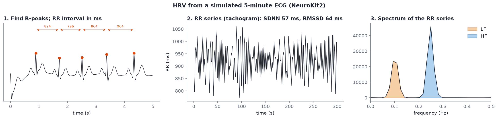

# HRV basics

After this module you will be able to:

- explain what heart rate variability is and how it is measured from ECG or PPG;
- say what RMSSD, SDNN, LF, HF and LF/HF measure, and the main caveat for each;
- explain respiratory sinus arrhythmia (RSA) and why breathing at about 6 breaths per minute makes the heart rhythm swing harder;
- name the three HRV training targets used in Divergence's HRV Training feature.

## What HRV is

**Heart rate variability (HRV)** is the beat-to-beat variation in the time between heartbeats. A healthy resting heart is not a metronome: the interval between beats changes all the time, mostly because the vagus nerve speeds and slows it in step with breathing and blood pressure. More of that flexibility at rest generally goes with better regulation; less of it goes with stress, fatigue and illness.

You get the beat times from one of two sensors:

- **ECG** (electrocardiogram): electrodes on the chest or wrists record the heart's electrical activity. The tall sharp spike in each beat is the **R-peak**, and it can be timed to within a millisecond.
- **PPG** (photoplethysmography): a light sensor on a finger, wrist or ear sees blood volume pulse with each beat. The pulse peak is rounder and arrives later than the R-peak, so PPG timing is a little less precise, but it is what most wearables use.

Either way, the raw material of HRV is the series of **RR intervals** (or "NN intervals", normal-to-normal, once ectopic beats are removed): the time in milliseconds from one beat to the next.


*A simulated 5-minute ECG from NeuroKit2 (not a recording). Drawn by `hrv_basics()` in `code/figures/make_figures.py`.*

The three panels are the whole pipeline: find R-peaks (left), turn them into an RR series, also called a tachogram (middle), and take the spectrum of that series (right).

## The metrics you will meet

Read the metrics section of [An Overview of Heart Rate Variability Metrics and Norms](https://pmc.ncbi.nlm.nih.gov/articles/PMC5624990/) (Shaffer and Ginsberg, 2017, open access, about 45 minutes). The short version:

| Metric family | The ones you will meet | What they index |
| --- | --- | --- |
| Time domain | RMSSD, SDNN, mean HR | RMSSD tracks vagal (parasympathetic) activity over short windows; SDNN is overall variability |
| Frequency domain | LF 0.04-0.15 Hz, HF 0.15-0.4 Hz, LF/HF | HF rides on breathing (respiratory sinus arrhythmia, RSA); LF rises sharply during slow paced breathing near 6 breaths per minute (resonance frequency) |
| Training targets | RSA amplitude, LF power, coherence | The three modes in Divergence's HRV Training feature; each rewards a different shape of the heart-rhythm curve during paced breathing |

### Time domain

- **Mean HR**: 60 000 divided by the mean RR interval in ms. Not variability, but always report it.
- **SDNN**: the standard deviation of all NN intervals in the window. Overall variability from every source. It grows with recording length, so only compare SDNN values computed over the same duration (5 minutes is the common short-term standard).
- **RMSSD**: the root mean square of successive differences, i.e. how much each interval differs from the one before it. Because it looks at beat-to-beat change, it is dominated by fast, vagally mediated variation, and it is reasonably stable even in windows of a minute or less. It is the go-to short-window metric.

### Frequency domain

Take the RR series, resample it evenly (the beats are not evenly spaced), and compute a spectrum, just as you did for EEG in [Module 10](10-spectral-features.md) but at much lower frequencies:

- **HF, 0.15-0.4 Hz** (9-24 breaths per minute): variation at the breathing rate. This is **respiratory sinus arrhythmia (RSA)**: heart rate speeds up as you breathe in and slows as you breathe out, driven by the vagus nerve.
- **LF, 0.04-0.15 Hz**: slower rhythms, including the roughly 10-second blood-pressure (baroreflex) oscillation.
- **LF/HF**: the ratio. Once sold as "sympathetic/parasympathetic balance".

> [!WARNING]
> The LF/HF ratio is widely reported and widely criticised. LF is not a clean measure of sympathetic activity, and the ratio depends heavily on breathing rate. If someone breathes slower than 9 breaths per minute, their RSA moves out of HF and into LF, and LF/HF jumps without any change in "balance". Shaffer and Ginsberg discuss this; read that part carefully.

## Resonance breathing and the training targets

When you breathe at about **6 breaths per minute** (0.1 Hz, one breath every 10 seconds), the breathing rhythm lines up with the baroreflex rhythm. The two reinforce each other, and the heart-rate swings with each breath get much bigger: a large, smooth, sine-like RR curve. That breathing rate, which varies a little from person to person, is the **resonance frequency**, and HRV biofeedback mostly trains people to breathe there.

The lab script shows the effect on the numbers. It builds two RR series by hand with the same mean heart rate: one breathing at 15 per minute, one at 6 per minute with a bigger RSA swing (the doubling is a modelling choice, roughly in line with what resonance-breathing studies report):

```text
  metric          15 breaths/min  6 breaths/min
  mean HR (bpm)            66.71          66.76
  SDNN (ms)                16.24          29.37
  RMSSD (ms)               21.49          19.40
  LF (ms²)                 14.20         751.68
  HF (ms²)                169.29          19.70
  LF/HF                     0.08          38.16
```

Same heart rate, but LF power goes up about fifty-fold and LF/HF goes from 0.08 to 38, purely because the breathing moved from the HF band into the LF band. Notice also that RMSSD barely changes: slow, smooth swings produce small beat-to-beat differences even when the total swing is large.

The **three HRV Training modes** in Divergence each reward a different shape of that curve during paced breathing:

- **RSA amplitude**: the size of the heart-rate swing within each breath (peak to trough).
- **LF power**: power in the 0.04-0.15 Hz band, which is where resonance breathing pushes the rhythm.
- **Coherence**: how much of the HRV spectrum is concentrated in one narrow peak, i.e. how smooth and sine-like the rhythm is.

> [!NOTE]
> The exact formulas Divergence uses for each mode (window lengths, how coherence is normalised) are something to ask Alex about. The ideas above are the standard ones from the HRV biofeedback literature.

## Try it

NeuroKit2 computes all of these from an ECG or PPG trace in a few lines (`nk.ecg_process`, `nk.hrv`); its [documentation](https://neuropsychology.github.io/NeuroKit/) includes an HRV tutorial.

```bash
pip install neurokit2
python code/labs/m14_hrv.py
```

Part 1 simulates a 5-minute ECG, detects 326 R-peaks, and prints mean HR 65.3 bpm, SDNN 56.8 ms, RMSSD 64.1 ms, LF 981 ms², HF 1313 ms², LF/HF 0.75. Part 2 prints the breathing comparison above.

The core of Part 1, if you want it in a notebook:

```python
import neurokit2 as nk

ecg = nk.ecg_simulate(duration=300, sampling_rate=1000, heart_rate=65, heart_rate_std=4, random_state=3)
signals, info = nk.ecg_process(ecg, sampling_rate=1000)
hrv = nk.hrv(info["ECG_R_Peaks"], sampling_rate=1000)   # one row, dozens of columns
print(hrv[["HRV_MeanNN", "HRV_SDNN", "HRV_RMSSD"]])
```

> [!TIP]
> The lab script computes LF and HF by hand (resample the RR series at 4 Hz, Welch, integrate) so every step is visible and the units are clearly ms². NeuroKit2's `nk.hrv_frequency()` does the same job; check its documentation for the units it reports before comparing numbers across tools.

Things to try:

1. In Part 2, change the slow rate from 6 to 8 and then 10 breaths per minute. At what point does the power move back into HF?
2. Change `heart_rate_std` in the simulation from 4 to 1. Which metrics fall most?
3. Shorten the simulation to 60 seconds. Which metric changes least? (It should be RMSSD.)

## Self-check

<details><summary>What is an RR interval, and why do you need to resample the RR series before taking a spectrum?</summary>

The time between two successive R-peaks, in ms. Beats are not evenly spaced in time, but the usual spectral methods assume evenly spaced samples, so the series is interpolated onto a regular grid (often 4 Hz) first.
</details>

<details><summary>RMSSD or SDNN: which would you use for a 60-second window during a session, and why?</summary>

RMSSD. It is based on successive differences, reflects fast vagal variation, and is reasonably stable over short windows. SDNN depends strongly on recording length.
</details>

<details><summary>Someone switches from breathing 15 times a minute to 6. What happens to LF, HF and LF/HF?</summary>

The breathing-linked variation moves from HF (0.25 Hz) to LF (0.1 Hz) and gets bigger, so LF rises sharply, HF falls, and LF/HF jumps, without any real change in "sympathetic balance".
</details>

<details><summary>Name the three HRV Training targets and what each rewards.</summary>

RSA amplitude (the size of the heart-rate swing within each breath), LF power (power in 0.04-0.15 Hz, where resonance breathing puts the rhythm), and coherence (how concentrated the spectrum is in one smooth peak).
</details>

If your project is the heart-brain correlation study, the [heart-brain branch](../project-branches.md) is the next layer: how to window EEG band power and HRV together, and why most published null results come from windows that were too short.

Next: [Module 15, Divergence orientation](15-divergence-orientation.md).
