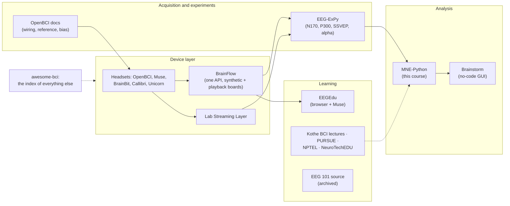

# Open-source projects

The course leans on MNE-Python for the hands-on work, but the open EEG ecosystem is much bigger than one library. This page covers the projects worth knowing in your first month: where to stream data from, which no-code tools let you see a pipeline before you write one, and which free courses and decks go deeper than these modules.

Everything below is open source or openly licensed, and nothing here asks for an account. Where a site has a request form for part of its material, the entry says so.

> [!NOTE]
> **EEG 101 is retired.** NeuroTechX archived the app in 2021 after InterAxon closed the Muse SDK, and its README now points to **EEGEdu** as the successor. The source is still worth reading, which is why it is listed first.

## How they fit together



Read it left to right. A **headset** produces voltages. **BrainFlow** or **Lab Streaming Layer** turns them into a stream your code can read. An experiment framework such as **EEG-ExPy** records that stream with event markers. An analysis library (**MNE-Python** in this course, **Brainstorm** if you want a GUI) turns the recording into spectra and ERPs. The **learning** projects explain each step, and **awesome-bci** indexes the parts this page leaves out.

## At a glance

| Project | Kind | Login? | Best first use | Connects to |
| --- | --- | --- | --- | --- |
| [EEG 101](#eeg-101) | Archived Android tutorial | No | Read the five-screen tutorial text | [02](modules/02-frequency-bands.md), [07](modules/07-filtering.md) |
| [EEGEdu](#eegedu) | Browser modules + live Muse | No | Watch your own alpha appear | [02](modules/02-frequency-bands.md), [06](modules/06-lab-1-find-the-alpha-peak.md) |
| [EEG-ExPy](#eeg-expy) | Python experiment library | No | Run an N170/P300 notebook on bundled data | [11](modules/11-epochs-and-erps.md) |
| [BrainFlow](#brainflow) | Device SDK | No | Stream the synthetic board | [13](modules/13-neurofeedback-loop.md) |
| [Introduction to Modern BCI Design](#introduction-to-modern-bci-design) | Lectures + slide PDFs | No | Lecture on EEG basics | [01](modules/01-where-the-signal-comes-from.md), [07](modules/07-filtering.md), [09](modules/09-artifact-handling.md) |
| [awesome-bci](#neurotechx-awesome-bci) | Curated index | No | Find a dataset or tool | All |
| [NeuroTechEDU lessons](#neurotechedu-lessons) | Written primers | No | One lesson as a warm-up | [01](modules/01-where-the-signal-comes-from.md) |
| [OpenBCI docs: EEG setup](#openbci-docs-eeg-setup) | Hardware how-to | No | The reference and bias section | [03](modules/03-electrodes-and-montages.md), [08](modules/08-re-referencing.md) |
| [Brainstorm](#brainstorm) | Free GUI application | No | First intro tutorial | [04](modules/04-reading-a-raw-trace.md), [09](modules/09-artifact-handling.md) |
| [PURSUE course](#pursue-course-modules) | 13-module course | Decks no; labs by request form | Module list after Module 1 | [01](modules/01-where-the-signal-comes-from.md) |
| [NPTEL, IISc](#introductory-neuroscience-and-neuro-instrumentation-nptel) | Lecture series | No for YouTube; enrolment only for certification | Weeks 2-4 | [01](modules/01-where-the-signal-comes-from.md), [07](modules/07-filtering.md) |

## Device layer and streaming

### BrainFlow

**[BrainFlow](https://brainflow.readthedocs.io/en/stable/SupportedBoards.html)** is an open-source SDK that streams from OpenBCI, Muse, BrainBit, Callibri, Unicorn and many other boards through one API, with Python, Node, Java and more bindings. It also has a **synthetic board** and a **playback-file board**. No login.

**Why it is on the map.** It is the device layer under most open EEG tooling, including EEG-ExPy below. The synthetic and playback boards let you test a real-time pipeline with no headset at all. Several of the boards it supports are ones Divergence integrates; two of the course samples come from BrainBit and Callibri-family hardware.

**Try it in 10 minutes.** `pip install brainflow`, then run the course script:

```bash
python code/labs/m13_brainflow_stream.py
```

It starts the synthetic board, pulls the newest 2 s every 0.5 s, filters causally and prints band power. The synthetic board puts a sine of about 5 × n Hz on its n-th channel, which gives you a built-in answer key. A real run printed:

```text
Synthetic board: 16 EEG channels at 250 Hz: Fz, C3, Cz, C4, Pz, PO7, Oz, PO8, F5, F7, F3, F1, F2, F4, F6, F8
  t (s)       Fz theta/alpha/beta       C3 theta/alpha/beta       Cz theta/alpha/beta
    0.0        21.0/   0.0/   0.0         5.5/ 144.9/   0.1         0.1/   7.0/ 324.4
    0.5        21.1/   0.0/   0.0         5.4/ 143.8/   0.1         0.0/   7.1/ 327.2
...
Mean band power over the run (µV², synthetic signal):
   Fz: theta    21.0  alpha     0.0  beta     0.0   -> mostly theta
   C3: theta     5.4  alpha   144.7  beta     0.1   -> mostly alpha
   Cz: theta     0.1  alpha     7.3  beta   331.0   -> mostly beta
```

Swap `BoardIds.SYNTHETIC_BOARD` for your device's board id and the loop is unchanged. That is the whole point of a device layer.

**Connects to:** [Module 13, The neurofeedback loop](modules/13-neurofeedback-loop.md), steps 1 and 3 of the loop.

### OpenBCI docs: EEG setup

**[OpenBCI's EEG setup guide](https://docs.openbci.com/GettingStarted/Biosensing-Setups/EEGSetup/)** covers electrode wiring, reference and bias, 10-20 placement, and a walk-through of recording your own alpha waves. No login, and the whole [docs site](https://docs.openbci.com/) is MIT licensed.

**Why it is on the map.** It is the most practical "what is a reference electrode" page on the web. Modules 03 and 08 explain references in the abstract; this page shows which physical pin the reference and bias wires go into and why the bias electrode exists.

**Try it in 10 minutes.** Read the reference and bias part of the page, then answer the [Module 08](modules/08-re-referencing.md) self-check question about why Cz goes flat under a Cz reference. If you have an OpenBCI board, the alpha walk-through is the hardware version of [Lab 1](modules/06-lab-1-find-the-alpha-peak.md).

**Connects to:** [Module 03](modules/03-electrodes-and-montages.md), [Module 08](modules/08-re-referencing.md).

## Experiments and analysis

### EEG-ExPy

**[EEG-ExPy](https://github.com/NeuroTechX/eeg-expy)** (formerly eeg-notebooks, NeuroTechX) is a Python library of classic EEG experiments: visual N170, P300, SSVEP and alpha. It is built on BrainFlow, PsychoPy and MNE, with [documentation](https://neurotechx.github.io/EEG-ExPy/) and bundled example datasets. No login.

**Why it is on the map.** Its analysis notebooks run on the bundled data without any hardware, so you can see a full experiment-to-plot pipeline in MNE. It is maintained from Toronto (John Griffiths, U of T).

**Try it in 10 minutes.** Open the documentation, pick the visual P300 or N170 example, and follow its analysis section on the bundled data. Compare what it does with [Module 11](modules/11-epochs-and-erps.md): find the epoching step, the baseline correction and the rejection threshold in its code.

**Connects to:** [Module 11, Epochs and ERPs](modules/11-epochs-and-erps.md).

### Brainstorm

**[Brainstorm](https://neuroimage.usc.edu/brainstorm/Tutorials/AllIntroduction)** (USC and McGill) is a free GUI application for MEG/EEG analysis. A compiled version runs without a MATLAB licence, and the introduction tutorials work step by step on a provided dataset, plus an EEG-specific tutorial. No login.

**Why it is on the map.** It is a no-code way to see filtering, artifact rejection, spectra and source maps before writing any Python. If Lab 1 feels like too much code at once, do the same thing by clicking first.

**Try it in 10 minutes.** Install the compiled version, open the first introduction tutorial, and import one of the course EDFs (`data/samples/s01_rest_eyes-closed_19ch.edf`). Look at the raw trace and the power spectrum and find the 10 Hz alpha peak you know is there.

**Connects to:** [Module 04, Reading a raw trace](modules/04-reading-a-raw-trace.md), [Module 09, Artifact handling](modules/09-artifact-handling.md).

## Learning: interactive

### EEGEdu

**[EEGEdu](https://github.com/kylemath/EEGEdu)** (Mathewson lab, University of Alberta) is the browser-based successor to EEG 101: interactive modules on the raw signal, filtering, spectra, bands and evoked responses, streaming live from a Muse over Web Bluetooth. MIT licence, used in a 100-student undergraduate course. No login.

**Why it is on the map.** If a Muse 2 or Muse S is available, this is the fastest hands-on orientation there is: no install, just a browser.

**Try it in 10 minutes.** With a Muse on, open the live site linked from the README in a Chrome-family browser, connect over Bluetooth, and go to the spectra module. Close your eyes for 20 seconds and watch the back channels: that is [Lab 1](modules/06-lab-1-find-the-alpha-peak.md) happening on your own head. No Muse? Our [Signal Lab](https://eeg-for-beginners.vercel.app/lab/signal-lab) does the same on the course recordings.

**Connects to:** [Module 02](modules/02-frequency-bands.md), [Module 06](modules/06-lab-1-find-the-alpha-peak.md).

### EEG 101

**[EEG 101](https://github.com/NeuroTechX/eeg-101)** (NeuroTechX) is an archived interactive Android tutorial (React Native + Java) that walked a Muse wearer through EEG neurophysiology, hardware, filtering, spectra and a simple BCI classifier. No login.

**Why it is on the map.** The app no longer runs against current Muse firmware, but the source is still readable. The tutorial text in `src` is a well-paced five-screen intro, and the signal classes show real-time filtering and plotting in a mobile app. That makes it a useful reference for the game-design team: it is a worked example of the same causal-filter-then-display loop as Module 13, inside a phone app.

**Try it in 10 minutes.** Browse `src` on GitHub and read the tutorial screens' text in order. Then find the filtering code and note whether it is causal (it has to be: it runs live).

**Connects to:** [Module 02](modules/02-frequency-bands.md), [Module 07](modules/07-filtering.md), [Module 13](modules/13-neurofeedback-loop.md).

## Learning: lectures, decks and lessons

### Introduction to Modern BCI Design

**[Introduction to Modern Brain-Computer Interface Design](https://sccn.ucsd.edu/wiki/Introduction_To_Modern_Brain-Computer_Interface_Design)** (Christian Kothe, SCCN/UCSD) is ten recorded lectures with downloadable slide PDFs: EEG basics, signal processing in BCIs, ERP processing, oscillatory processes, machine learning, plus Lab Streaming Layer and BCILAB tutorials. No login.

**Why it is on the map.** It is the best open deck set on EEG basics and signal processing for engineers. Kothe is also the author of **ASR** (artifact subspace reconstruction), so his lectures are background reading for the de-noising project in [project branches](project-branches.md).

**Try it in 10 minutes.** Download the slide PDF for the EEG basics lecture and skim it against [Module 01](modules/01-where-the-signal-comes-from.md). Mark one thing it explains differently.

**Connects to:** [Module 01](modules/01-where-the-signal-comes-from.md), [Module 07](modules/07-filtering.md), [Module 09](modules/09-artifact-handling.md).

### PURSUE course modules

**[PURSUE](https://pursue.richmond.edu/teaching-modules/full-semester-course/)** (University of Richmond) is a thirteen-module undergraduate EEG/ERP course, licensed CC BY-NC-SA 4.0. The decks are on the module pages; the data-processing labs and ERP datasets are available by **request form**.

**Why it is on the map.** Module 1's deck is already the Week 1 reading. The full module list covers signal generation, recording procedure and processing labs, so it is the natural next step once you have finished this course.

**Try it in 10 minutes.** Open the full module list and pick the module on recording procedure. Compare its checklist with the "first look at any file" checklist in [Module 04](modules/04-reading-a-raw-trace.md).

**Connects to:** [Module 01](modules/01-where-the-signal-comes-from.md) and onward.

### Introductory Neuroscience and Neuro-Instrumentation (NPTEL)

**[Introductory Neuroscience and Neuro-Instrumentation](https://onlinecourses.nptel.ac.in/noc20_ee95/preview)** (NPTEL, IISc Bangalore) is a university lecture series. Weeks 2-4 cover EEG recording systems, waveforms and signal conditioning, with EEGLAB demos. **No login for the YouTube lectures**; free enrolment only if you want certification.

**Why it is on the map.** It is an engineering-flavoured alternative to the psychology-flavoured decks: amplifiers, electrodes and signal conditioning rather than cognition.

**Try it in 10 minutes.** Watch the first part of the week 2 lecture on EEG recording systems, then reread the section on amplitudes and impedance in [Module 01](modules/01-where-the-signal-comes-from.md).

**Connects to:** [Module 01](modules/01-where-the-signal-comes-from.md), [Module 07](modules/07-filtering.md).

### NeuroTechEDU lessons

**[NeuroTechEDU lessons](http://learn.neurotechedu.com/lessons/)** (NeuroTechX) are free written lessons on EEG, BCI and neurotech basics. No login.

**Why it is on the map.** Short written primers for when you want to read rather than watch. They are community-maintained, so expect a few stale links.

**Try it in 10 minutes.** Read the EEG lesson as a warm-up before [Module 01](modules/01-where-the-signal-comes-from.md), and add any new term to your notes file.

**Connects to:** [Module 01](modules/01-where-the-signal-comes-from.md).

### NeuroTechX awesome-bci

**[awesome-bci](https://github.com/NeuroTechX/awesome-bci)** is a curated list of open-source software, hardware, datasets, courses and communities. No login.

**Why it is on the map.** It is the index to go to when this map runs out.

**Try it in 10 minutes.** Open its datasets section and find one resting-state EEG dataset to compare against the [course samples](data/README.md).

**Connects to:** everything.

## Also login-free

Already in the [resource library](resources.md) and also login-free: MNE tutorials, the FieldTrip and EEGLAB workshop videos, the EEGLAB wiki, Neural Data Science in Python, the Python EEG Handbook, and all the open-access papers. The one exception in the library is the ERP Boot Camp's *Introduction to ERPs*: free, but it needs an account on their course site.

## Self-check

<details><summary>You have no headset. Which two projects let you test a real-time pipeline anyway, and how?</summary>

BrainFlow, through its synthetic board (generated signal) or its playback-file board (a recording replayed as if live). EEG-ExPy's analysis notebooks also run on bundled data, though that is offline analysis rather than streaming.
</details>

<details><summary>Why is EEG 101 still worth reading if it is archived?</summary>

Its tutorial text is a well-paced five-screen intro, and its source shows real-time filtering and plotting inside a mobile app: a working example of the live loop in Module 13, useful for anyone designing a neurofeedback game.
</details>

<details><summary>Whose lectures should you read before working on ASR, and why?</summary>

Christian Kothe's *Introduction to Modern BCI Design*. Kothe wrote ASR, and the lectures cover the signal processing it builds on.
</details>

<details><summary>Which resource in this course needs an account, and which have a request form?</summary>

The ERP Boot Camp's *Introduction to ERPs* needs a free account on its course site. PURSUE's data-processing labs and ERP datasets are by request form; its decks are open. NPTEL needs enrolment only for certification.
</details>
