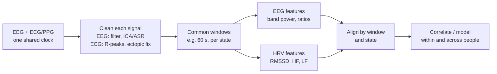
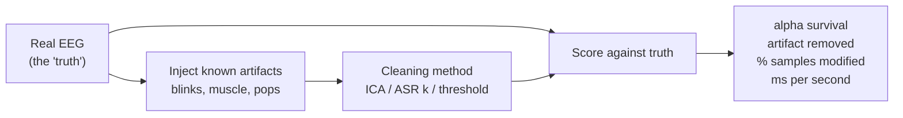
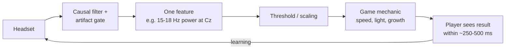

# Project branches

These are the next layer, for after the two weeks. Pick the branch that matches your project; none of it is in the six-hour budget. Each branch lists the readings from the syllabus, then what you will build, a pipeline sketch, a first week of tasks, the usual pitfalls, and which course modules and samples to go back to.

> [!NOTE]
> Every branch rests on the same four skills from the course: loading and filtering a recording ([Module 07](modules/07-filtering.md)), recognising artifacts ([Module 05](modules/05-artifacts-field-guide.md)), computing band power in windows ([Module 10](modules/10-spectral-features.md)), and the feedback loop ([Module 13](modules/13-neurofeedback-loop.md)). If any of those is shaky in your [checkpoints](checkpoints.md), fix it first.

## Heart-brain correlation (EEG + HRV across states)

### Read

- [Measures and Models of Brain-Heart Interactions](https://arxiv.org/abs/2409.15835) (Candia-Rivera, Faes, de Vico Fallani, Chavez, 2024) surveys the signal-processing approaches: feature correlation between EEG band power and HRV metrics, heartbeat-evoked potentials, and directional coupling models. Read the introduction and the section on feature-based methods first.
- [BrainBeats](https://www.biorxiv.org/content/10.1101/2023.06.01.543272v1) is an EEGLAB plugin that does joint EEG and ECG/PPG analysis (HRV and EEG features per window, heartbeat-evoked potentials, heart-artifact removal). Its paper is a readable map of what a brain-heart pipeline contains, even if you implement it in Python with MNE and NeuroKit2.

### What you will build

A pipeline that takes a simultaneous EEG + ECG (or PPG) recording, splits it into the same time windows, computes EEG band-power features and HRV metrics per window, and tests whether they move together across states such as focus, stress, relaxation and engagement. The deliverable is a table of window-level features per state and a correlation (or mixed-effects) analysis with honest error bars.

### The design note from the syllabus

Record EEG and heart signal simultaneously with one clock, hold each state (focus, stress, relaxation, engagement) for 2-5 minutes, compute band power and HRV metrics in the same windows, and only then correlate. Most published null results come from windows that were too short or from artifacts that leaked into both signals.

**Window alignment, concretely.** HRV metrics need many beats: RMSSD is usable over about a minute, but LF (0.04-0.15 Hz) needs a window long enough to hold several of its slowest cycles, so frequency-domain HRV wants windows of a couple of minutes or more ([Module 14](modules/14-hrv-basics.md) shows why). EEG band power is stable over a few seconds. So the HRV window sets the pace: compute EEG band power in short sub-windows (say 2 s Welch segments) inside each HRV window and average them, so that each row of your table has one HRV value and one EEG value covering exactly the same seconds. Drop any window where either signal had an artifact, not just the one where you happened to notice it.

### Practise with what the course has

The course samples have **no ECG channel**, so you cannot run the full pipeline on them. Practise the two halves separately and wire them together:

- HRV half: `python code/labs/m14_hrv.py` simulates an ECG with NeuroKit2, finds R-peaks and computes RMSSD, SDNN, LF and HF ([Module 14](modules/14-hrv-basics.md)). Change it to compute the metrics in consecutive 60 s windows instead of once.
- EEG half: `python code/labs/m10_band_power.py` computes band power ([Module 10](modules/10-spectral-features.md)). Change it to output band power in the same 60 s windows on `rest_ec` and `rest_eo`.
- Join the two tables on window start time. The numbers will be meaningless (the heart is simulated), but the plumbing is exactly what the real recording needs.

### First week

1. Read the Candia-Rivera introduction and feature-based section; write down the three families of methods in one line each.
2. Skim the BrainBeats paper and list its pipeline steps; mark which ones MNE or NeuroKit2 already does.
3. Build the windowed practice pipeline above and commit it.
4. With Alex, decide the states, their order, durations, and the hardware that records both signals on one clock.

### Pitfalls

- **Windows too short** for HRV frequency-domain metrics (the syllabus's first warning).
- **Artifacts in both signals at once.** Movement and talking disturb EEG and heart rate together and produce a correlation that is about the participant moving, not about brain-heart coupling.
- **The heartbeat in the EEG.** The cardiac field can appear in EEG channels (the ECG artifact in [Module 05](modules/05-artifacts-field-guide.md)); if it does, EEG and HRV are trivially correlated. Check for it, and remove it (ICA, or BrainBeats's heart-artifact removal) before correlating.
- **Breathing drives both.** Slow breathing raises LF ([Module 14](modules/14-hrv-basics.md)) and can change EEG too; record or control breathing rate.
- **Pooling people.** Correlating across all windows from all participants mixes between-person and within-person effects. Analyse within person first.

## ASR/ICA validation (EEG de-noising pipeline)

### Read

- Re-read the [clean\_rawdata README](https://github.com/sccn/clean_rawdata), including the Makoto wiki page it links on ASR parameters; the burst-removal cutoff in standard deviations is the knob you will be evaluating.
- Work through the [mne-denoise ASR basics example](https://mne.tools/mne-denoise/auto_examples/asr/plot_01_asr_basics.html); it builds synthetic EEG with known bursts, which is exactly the validation trick you want: inject artifacts you control, then measure how much of the brain signal survives cleaning.
- [mne-icalabel](https://mne.tools/mne-icalabel/stable/index.html) gives you an automatic component classifier to compare against manual ICA labelling, and the EEGLAB workshop slides on [artifact rejection and ICA](https://sccn.ucsd.edu/githubwiki/files/eeglab2017_aspet_artifact_and_ica.pdf) list the data-length and preprocessing conditions ICA needs to work at all.

### What you will build

A validation harness: take real EEG, add artifacts whose shape and timing you know exactly, run each cleaning method, and score it against the untouched original. The syllabus's metrics to have in mind:

- before/after power spectra on clean segments (the alpha peak must survive);
- signal-to-noise on injected artifacts;
- fraction of samples modified;
- runtime per second of data, if the pipeline has to run online.

### A working starting point

`code/labs/branch_asr_validation.py` does this on two minutes of `s01_rest_eyes-closed_19ch.edf` (from 60 s, 1-40 Hz, average reference). It injects 15 blinks (120-220 µV at Fp1/Fp2, falling off toward the back) and 14 one-second muscle bursts (20-45 Hz noise, 25 µV SD, on T3, T4, T5, T6, F7, F8), then compares ICA, a simple amplitude-threshold rejection, and ASR from mne-denoise at two cutoffs. It also runs every method on the original with nothing injected, as a control. Output from one run:

| Method | Alpha peak at O1/O2 | Alpha power change | Brain error | Blink removed | Muscle removed | Samples modified | Control | ms per s of data |
| --- | --- | --- | --- | --- | --- | --- | --- | --- |
| no cleaning | 10.0 Hz | +0.0% | 0.0% | 0% | 0% | 0.0% | 0.0% | 0.0 |
| ICA (blink component) | 10.0 Hz | -0.0% | 7.7% | 95% | 1% | 98.5% | 95.3% | 0.9 |
| threshold (5× median p-p) | 10.0 Hz | +0.0% | 0.0% | 27% | 0% | 3.7% | 1.2% | 0.0 |
| ASR, k = 20 | 10.0 Hz | -0.6% | 50.1% | 94% | -5% | 34.2% | 29.4% | 4.3 |
| ASR, k = 10 | 10.0 Hz | -2.6% | 58.3% | 94% | 13% | 51.9% | 47.0% | 4.0 |

*Brain error: RMS difference from the original on segments more than 1 s from any injected event, as a percentage of the original's SD, median over channels. Control: samples modified when the method runs on the original with nothing injected. Timings are from one desktop run and will vary.*

What the table already teaches:

- **Every method kept the alpha peak at 10.0 Hz**, and alpha power moved by under 3%. "The alpha peak survives" is necessary but nowhere near sufficient.
- **ICA removed 95% of the blinks while barely touching the waveform** (7.7% brain error), but it "modifies" 98.5% of samples because removing a component changes every sample a little. Fraction-modified needs a threshold that matches the question.
- **The threshold rejector is too lax at 5×**: it caught only 31% of blink samples. Tune the factor and watch the trade-off against data thrown away.
- **Nobody removed the muscle.** The injected bursts are independent noise on each temporal channel, which is roughly what muscle looks like: there is no single spatial source for ICA to isolate, and at 25 µV they sit under ASR's thresholds. This is the hard case for your project.
- **The control column is the most important one.** ASR at k = 20 changed 29% of samples of a recording with nothing injected, and k = 10 changed 47%. Part of that is real: s01 has its own frontal transients that ASR repairs, which also inflates its "brain error". Part may be the implementation: mne-denoise was at version 0.0.3 when this was written, and `asrpy` 0.0.8 crashed with the current NumPy. Explaining that control number, by comparing against EEGLAB's `clean_rawdata` on the same file, is a good first project question.

> [!TIP]
> To add a method, write a function `raw -> (cleaned_raw, kept_mask, note)` and add it to `METHODS` in the script; it gets the same scores and the control run for free. Good first additions: ICA with components picked by mne-icalabel instead of correlation, and ASR calibrated on a hand-picked clean minute instead of `auto`.

### First week

1. Run the harness, read the code, and reproduce the table.
2. Add electrode pops (a step on one channel) and slow drift to the injected artifacts.
3. Sweep the ASR cutoff (5, 10, 20, 30) and plot blink removed against control samples modified; that curve is the knob the syllabus means.
4. Swap the correlation-based ICA selection for mne-icalabel and compare.
5. Repeat on `s06_pipeline_stage0_raw_19ch.edf`, whose blinks are real, and compare against the platform's own `s08` output ([Module 09](modules/09-artifact-handling.md)).

### Pitfalls

- **A dirty "truth".** Real recordings already contain artifacts; a method that cleans them is penalised for differing from the truth. Pick the cleanest stretch you can, or report the control run alongside.
- **Injecting what your method expects.** Synthetic blinks with a perfect frontal topography are easy for ICA; vary amplitude, shape and topography.
- **Calibration leaks.** If ASR calibrates on data that contains the injected artifacts, its thresholds move. Report what it calibrated on.
- **ICA's preconditions.** Enough data for the number of channels, high-pass filtered input, and no huge transients; the EEGLAB slides list them. Two minutes of 19 channels is on the short side.
- **Offline vs online.** Zero-phase filters and whole-recording ICA are not available in real time ([Module 13](modules/13-neurofeedback-loop.md)); time the online version separately.

## Neurally controlled game design (mobile)

### Read

- [Turning Shortcomings into Challenges: Brain-Computer Interfaces for Games](https://research.utwente.nl/en/publications/turning-shortcomings-into-challenges-brain-computer-interfaces-fo/) (Nijholt, Plass-Oude Bos, Reuderink, 2009) and the chapter [Brain-Computer Interfacing and Games](https://research.utwente.nl/en/publications/brain-computer-interfacing-and-games/) (Plass-Oude Bos et al., 2010) are the classic framing: brain input is slow and noisy, so the game design has to turn that into a mechanic rather than fight it. Both are short.
- [Competing and collaborating brains](https://research.utwente.nl/en/publications/competing-and-collaborating-brains-multi-brain-computer-interfaci/) (Nijholt) covers multiplayer and social designs if that is on the table.
- The feedback section of [Enriquez-Geppert et al. (2017)](https://pmc.ncbi.nlm.nih.gov/articles/PMC5319996/) explains why feedback has to be immediate, proportional, and tied to one feature; a game that rewards the wrong thing trains the wrong thing.

### What you will build

A game design (and eventually a prototype) where one EEG feature drives one game mechanic, with the delay and noise of that feature designed into the mechanic instead of hidden. Before proposing scenes and rewards, ask Alex to show you the existing feedback response types in Dive so the proposal plugs into what is already there.

### Design rules that follow from the course

- **The feature updates a few times a second and lags by a fraction of a second.** In [Module 13](modules/13-neurofeedback-loop.md) the replay uses a 1 s window updated every 250 ms. Mechanics that need millisecond reactions will feel broken; mechanics that change gradually (a boat speeding up, a scene brightening) will not.
- **The feature is noisy.** In the Module 13 replay on real eyes-open EEG, feedback was on about a third of the time even with nobody trying. Smooth it, and make "almost there" visible.
- **Artifacts are cheats.** A blink floods theta and a jaw clench raises high beta; if those bands drive the game, players will learn to blink or clench. Gate them (`code/labs/m13_neurofeedback_replay.py` shows what a gate does to the success rate).
- **One feature, one mechanic.** The Enriquez-Geppert feedback section: proportional and tied to one feature, or you train the wrong thing.

### First week

1. Read the two Nijholt-group papers and list three "shortcomings turned into challenges" you could use.
2. Run `python code/labs/m13_neurofeedback_replay.py` and change the window and update interval; note how the reward stream feels at each setting.
3. Ask Alex for the Dive feedback response types; map each to a mechanic.
4. Paper-prototype one level around one feature, with the artifact gate's behaviour designed in (what does the game do while the gate is closed?).

### Pitfalls

- **Rewarding the wrong thing**: a mechanic that responds to blinks, clenches or movement.
- **Hiding the latency**: players blame themselves for a lag they cannot see.
- **Too many inputs**: mixing several features into one score makes it impossible to learn what is being rewarded.
- **Multiplayer fairness**: different headsets and contact quality give different signal levels; normalise per player before comparing.

## Where to look next

The [open-source projects](open-source.md) page lists tools (BrainFlow for streaming, EEG-ExPy for experiments, Kothe's BCI lectures on ASR) that each branch can build on, and the [resource library](resources.md) has the longer menu.
