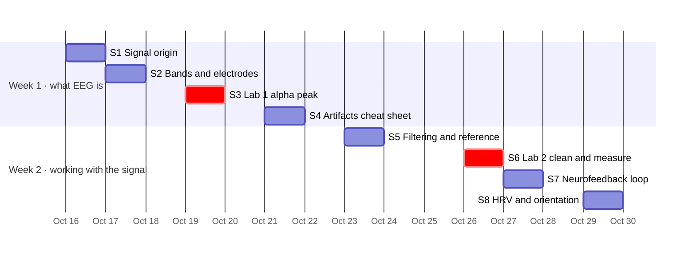

# Day-by-day schedule

Eight sessions, about six hours in total. Tick them off as you go. **The order matters**: each hands-on session reuses the previous one's data and code.

Each session is 30-45 minutes; give the two hands-on sessions (3 and 6) a dedicated 60-90 minute block. Pair up where it helps: one person drives, the other reads the docs.

The dates are suggestions. Spread the sessions however suits you inside each week.

## Week 1 (Oct 16-22): what EEG is, and your first plot

By the end of Week 1 you should be able to look at a raw EEG trace and say where the signal comes from, which rhythm you are looking at, which electrode you are looking at, and whether a bump is brain or artifact.

- [ ] **Session 1 (30 min)**: [Module 00, Start here](modules/00-start-here.md) and [Module 01, Where the signal comes from](modules/01-where-the-signal-comes-from.md).
  - Watch [2-Minute Neuroscience: EEG](https://neuroscientificallychallenged.com/posts/2-minute-neuroscience-electroencephalography-eeg), then Cohen's "Introduction to EEG time series" ([ANTS playlist](https://www.youtube.com/watch?v=ukjuFUghieg&list=PLn0OLiymPak0t1moK3sn4Sl1seXlEOPHT), lecture 1).
  - **Produce:** your notes file in the project repo, started from the [notes template](notes-template.md).
- [ ] **Session 2 (45 min)**: [Module 02, Frequency bands](modules/02-frequency-bands.md) and [Module 03, Electrodes and montages](modules/03-electrodes-and-montages.md).
  - Read the PURSUE "Basics of EEG & ERPs" deck ([Module 1](https://pursue.richmond.edu/teaching-modules/full-semester-course/module-1-overview-of-eeg-erp)) and the [10-20 system](<https://en.wikipedia.org/wiki/10%E2%80%9320_system_(EEG)>) page.
  - **Produce:** close the browser and sketch a head with Fp1, Fp2, F3, Fz, F4, C3, Cz, C4, P3, Pz, P4, O1, O2, T3/T7, T4/T8 from memory. Check it against the electrode figure in Module 03.
- [ ] **Session 3 (60-90 min)**: [Module 04, Reading a raw trace](modules/04-reading-a-raw-trace.md) and [Module 06, Lab 1: find the alpha peak](modules/06-lab-1-find-the-alpha-peak.md).
  - Install MNE-Python (`pip install -r code/requirements.txt` in a fresh virtual environment) and run the eyes-open vs eyes-closed script.
  - **Produce:** the two spectra, plus screenshots of one blink and one muscle burst, saved to your notes.
- [ ] **Session 4 (20-30 min)**: [Module 05, Artifacts field guide](modules/05-artifacts-field-guide.md).
  - Watch the EEGLAB workshop video "Removing Artifactual Components" (Delorme, on the [Online EEGLAB Workshop](https://www.sccn.ucsd.edu/wiki/Online_EEGLAB_Workshop) page) or Keil's "EEG Data Analysis Part 3 - Basics" (on the [FieldTrip video page](https://www.fieldtriptoolbox.org/video/)).
  - **Produce:** a one-page artifact cheat sheet: blink, eye movement, muscle, heartbeat, line noise, electrode pop. What each looks like and where. The notes template has a table to fill in.

## Week 2 (Oct 23-29): cleaning, features, and the feedback loop

Week 2 turns "I can see alpha" into "I can clean a recording and compute numbers from it".

- [ ] **Session 5 (45 min)**: [Module 07, Filtering](modules/07-filtering.md), [Module 08, Re-referencing](modules/08-re-referencing.md), and the first half of [Module 10, Spectral features](modules/10-spectral-features.md).
  - Read the MNE [filtering](https://mne.tools/stable/auto_tutorials/preprocessing/30_filtering_resampling.html) and [reference](https://mne.tools/stable/auto_tutorials/preprocessing/55_setting_eeg_reference.html) tutorials. Watch one of Cohen's "Static spectral analysis" lectures.
  - **Produce:** two sentences in your notes: what a high-pass at 1 Hz removes, and why a notch at 60 Hz is needed in Toronto.
- [ ] **Session 6 (60-90 min)**: [Module 09, Artifact handling](modules/09-artifact-handling.md) and [Module 12, Lab 2: clean and measure](modules/12-lab-2-clean-and-measure.md). Skim [Module 11, Epochs and ERPs](modules/11-epochs-and-erps.md) for vocabulary.
  - Run the ICA hands-on: identify and remove the blink component, compute alpha power per channel.
  - **Produce:** three sentences: which component you removed and how you knew, what changed in the frontal channels after removal, and which three channels have the highest alpha power.
- [ ] **Session 7 (50 min)**: [Module 13, The neurofeedback loop](modules/13-neurofeedback-loop.md).
  - Read the first half of [Enriquez-Geppert et al. (2017)](https://pmc.ncbi.nlm.nih.gov/articles/PMC5319996/). Run `python code/labs/m13_neurofeedback_replay.py`.
  - **Produce:** draw the five-step neurofeedback loop from memory, and write one paragraph on how a reward/inhibit protocol works.
- [ ] **Session 8 (40 min)**: [Module 14, HRV basics](modules/14-hrv-basics.md) and [Module 15, Divergence orientation](modules/15-divergence-orientation.md).
  - Read the metrics section of [Shaffer and Ginsberg (2017)](https://pmc.ncbi.nlm.nih.gov/articles/PMC5624990/). Optional: `pip install neurokit2` and run `python code/labs/m14_hrv.py`, or the HRV example from the [NeuroKit2 docs](https://neuropsychology.github.io/NeuroKit/) on the built-in sample ECG.
  - **Produce:** the list of questions you want to ask Alex.

## Before the first meeting

- [ ] Go through [Checkpoints](checkpoints.md) and mark anything you cannot do yet. Bring the list, your notes file, and your lab outputs.

## After the two weeks

Once the [checkpoints](checkpoints.md) are ticked, pick the branch that matches your project in [Project branches](project-branches.md): heart-brain correlation, ASR/ICA validation, or neurally controlled game design. None of it is in the six-hour budget.

## If you fall behind

Do the hands-on sessions (3 and 6) and the vocabulary in [Module 15](modules/15-divergence-orientation.md) first. Everything else can be caught up with the [resource library](resources.md) afterwards. You do not need to finish every linked resource; the modules say what to read, watch, or run, and the library is the longer menu.
